# 🌍 Art City Intelligence

> **"유명한 도시가 아니라, 가능성 있는 도시를 찾는다."**

세계 18개 도시의 예술 생태계 데이터를 6개 차원으로 비교하고, 숫자의 출처와 공간·브랜드 기회까지 한 화면에서 읽는 **풀스택 데이터 분석 리포트 웹 도구**입니다.
Next.js 앱 하나에 리포트 화면(정적 페이지 33개), 조회 API 4개와 문의 메일 API, 관리자 인증을 담아 Vercel로 배포했습니다.

<div align="center">

[](https://art-city-intelligence.vercel.app/)
[](docs/art-city-intelligence_slides.html)
[](#data)


<br>

<a href="https://art-city-intelligence.vercel.app/"></a>

</div>

**🗓️ 작업 기간** 2026.09 제작 · 2026.11 코드 검토와 보완 · **👤 역할** 문헌 조사·지표 설계·화면 기획·풀스택 구현 검수·배포 안정빈 (1인) / 구현 보조 AI 코딩 도구

### 🏆 핵심 성과

| 도시 | 비교 차원 | 인용 문헌 | 화면 | API | 보안 경고 |
| :---: | :---: | :---: | :---: | :---: | :---: |
| **18개** | **6개** | **13건** | **8종** (정적 페이지 33개) | **5개** | **0건** (`npm audit`) |

### 🧱 풀스택 구성

| 계층 | 맡은 일 |
| --- | --- |
| 🖥️ 리포트 화면 | 개요·도시 상세·비교·방법론·관리자 8종, 도시 18곳 상세를 빌드할 때 미리 생성 |
| 🔌 API | `GET /api/cities` · `indicators` · `cultural` · `market` 조회, `POST /api/contact` 문의 메일 |
| 🔐 보안 | `src/proxy.ts`가 `/admin/*`에 Basic 인증, 설정이 없으면 잠김 · 문의 입력 검사·HTML 이스케이프·봇 차단 칸 |
| 📦 데이터 | 도시·6개 차원·관측 순위·문헌 13건을 TypeScript 모듈로, 화면과 API가 같은 도시 slug로 읽음 |
| ☁️ 배포 | Vercel, 환경 변수 4개 (메일 2 · 관리자 2) |

### ✨ 핵심 기능

| 🌐 탐색 | 📊 비교 | 🔎 출처 추적 | 💡 기회 |
| :---: | :---: | :---: | :---: |
| **지구본에서 도시 고르기** | **중앙값 대비로 읽기** | **관측값과 예시값 분리** | **도시별 공간·브랜드 제안** |
| 드래그 회전·도시 검색<br>신호 타일 4개<br>비교군 18개 도시 | 6개 차원 막대·레이더<br>가중치 ±10% 민감도<br>유사 도시 | 발행 순위 따로 표시<br>차원별 근거 문헌<br>OBSERVED·ILLUSTRATIVE 배지 | 도시 유형·DNA<br>연계 산업<br>제안 이유 한 문장 |

---

## 📑 목차

1. [🗂️ 개요](#overview)
2. [🎯 기획 배경](#background)
3. [🏗️ 시스템 아키텍처와 데이터 흐름](#architecture)
4. [📊 데이터 출처와 지표 정의](#data)
5. [⚖️ 해석 원칙](#interpret)
6. [✨ 주요 화면](#screens)
7. [🧩 기능별 핵심 특징과 구현 상세](#details)
8. [💡 기술적 의사결정](#decisions)
9. [📂 주요 폴더 구조와 데이터 모델](#structure)
10. [🚀 실행 방법](#run)
11. [✅ 검증 결과](#verify)
12. [📈 회고](#retro)
13. [🗺️ 로드맵](#roadmap)
14. [🎞️ 슬라이드](#slides)
15. [📄 라이선스와 자료 권리](#license)

---

<a id="overview"></a>
## 🗂️ 1. 개요

| 항목 | 내용 |
| --- | --- |
| 목표 | 도시의 예술 생태계를 하나의 순위가 아니라 여러 차원의 조합으로 읽고, 공간·브랜드 기회로 연결한다 |
| 원칙 | 규모와 밀도를 나눠 본다 · 비슷한 조건의 도시끼리 비교한다 · 발행된 관측값과 시연용 예시값을 섞지 않는다 |
| 대상 | 팝업·쇼룸·문화 프로그램을 기획하는 브랜드·공간 기획자 |
| 도시 | 서울, 베를린, 런던, 뉴욕, 멕시코시티, 멜버른, 암스테르담, 베이징, 바르셀로나, 시카고, 두바이, 홍콩, 파리, 베네치아, 바젤, 도쿄, 상하이, 싱가포르 (18개) |
| 기간 | 2026.09 |
| 역할 | 문헌 조사·지표 설계·화면 기획·풀스택 구현 검수·배포: 안정빈 (개인) / 구현 보조: AI 코딩 도구 |
| 형태 | 풀스택 웹 앱 — 리포트 화면 + 조회·문의 API + 관리자 인증 (Next.js 16, Vercel) |

<a id="background"></a>
## 🎯 2. 기획 배경

| 문제 | 왜 문제인가 | 해결 |
| --- | --- | --- |
| 문화도시 지표는 '유명한 도시'를 보여 준다 | 브랜드·공간 기획자가 찾는 것은 아직 덜 알려졌지만 조건이 맞는 도시 | 도시 유형·DNA·연계 산업·기회 제안을 도시마다 함께 보여 줌 |
| 대도시가 절대량에서 유리하다 | 기관 수·거래액 같은 총량은 인구가 많은 도시를 늘 위에 올림 | 18개 도시 중앙값과의 차이로 비교 |
| 단일 순위는 강점의 조합을 설명하지 못한다 | 시장은 약해도 제작·실험이 강한 도시가 묻힘 | EU 문화·창조도시 모니터 체계를 따른 6개 차원으로 분해 |
| 데이터와 근거가 흩어져 있다 | 숫자가 어디서 왔는지 알 수 없으면 의사결정에 못 씀 | 차원마다 근거 문헌, 발행 순위는 출처와 함께 따로 표시 |

| 단계 | 결정 |
| --- | --- |
| 문헌 조사 | UNESCO, EU Cultural and Creative Cities Monitor, OECD 문화·지역발전 문헌을 읽고 '규모와 밀도 분리', '유사 도시끼리 비교' 원칙을 세움 |
| 기획 전환 | '어떤 도시가 앞서는가'에서 '내 조건에 맞는 공간 전략은'으로. 도시 선택 → 유사 도시 비교 → 공간·브랜드 제안 흐름 |
| 범위 조정 | 40개 후보 도시 → 18개, 대규모 시뮬레이션 대신 가중치 ±10% 민감도, 네트워크·텍스트 분석은 다음 단계로 |
| 구현 | 개요·도시 상세·비교·방법론·관리자 화면을 만들고 배포 |
| 검토·보완 | 코드 검토로 조사 오류·스크롤 막힘·연결되지 않은 화면·관리자 접근·의존성 경고를 고침 ([회고](#retro)) |

<a id="architecture"></a>
## 🏗️ 3. 시스템 아키텍처와 데이터 흐름

### 🧱 기술 스택

| 계층 | 기술 | 이 프로젝트에서 맡은 일 |
| --- | --- | --- |
| Frontend | Next.js 16 (App Router), React 19, TypeScript strict | 공개·관리자 라우트, 도시 18개 상세를 미리 생성 |
| 시각화 | SVG · Canvas 직접 구현, `topojson-client` | 지구본(Natural Earth 110m 육지 경계), 레이더·막대·추세 차트 |
| 데이터 | TypeScript 모듈 (`features/*`) | 도시 데이터, 6개 차원, 관측 순위, 출처 13건 |
| API | Next.js Route Handlers | 도시·지표·문화·시장 조회, 문의 메일 |
| 보안 | Next.js Proxy (`src/proxy.ts`) | `/admin/*` Basic 인증, 환경 변수가 없으면 잠김 |
| 외부 서비스·배포 | Resend, Vercel | 문의 메일 발송, 배포 |

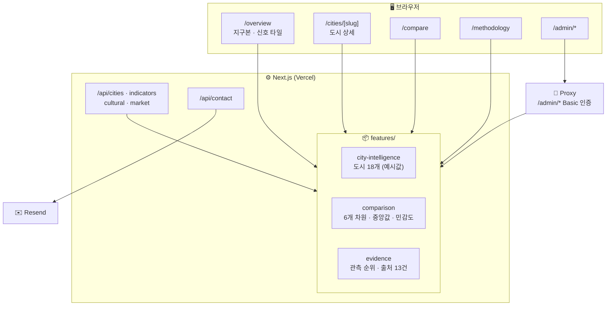

### 🔄 데이터 처리 흐름

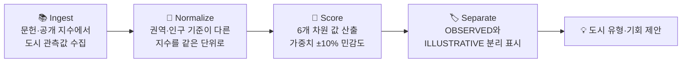

### 🧭 사용 흐름

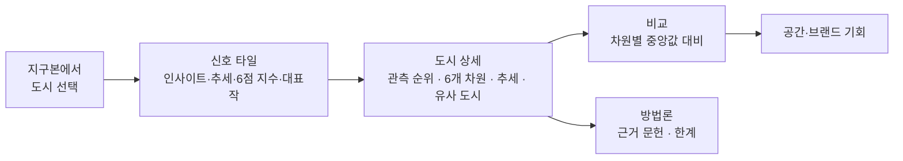

| API | 입력 | 응답 |
| --- | --- | --- |
| `GET /api/cities` | `?slug=` (없으면 전체) | 도시 목록 또는 도시 한 곳 |
| `GET /api/indicators` | `?city=` | 6개 차원 점수·민감도·근거 문헌 |
| `GET /api/cultural` · `/api/market` | `?city=` | 기관·행사·키워드 / 작가·가격대(참고) |
| `POST /api/contact` | 이름·연락처·이메일 | Resend로 메일 발송, 빈 칸·이메일 형식 검사 (400), 키 없음 503, 발송 실패 502 |

<a id="data"></a>
## 📊 4. 데이터 출처와 지표 정의

### 📐 6개 차원

EU 공동연구센터의 Cultural and Creative Cities Monitor(C3, 2023)의 세 하위지수 아래에 차원을 두고, 차원마다 정의를 받친 연구를 하나씩 연결했습니다.

| 차원 | C3 하위지수 | C3 차원 | 근거 문헌 | 가중치 |
| --- | --- | --- | --- | :---: |
| 시장 Market | Creative Economy | Creative & Knowledge-based Jobs | Beckert & Rössel (2013) | 1.00 |
| 기관 Institution | Cultural Vibrancy | Cultural Venues & Facilities | JRC C3 (2023) | 0.96 |
| 제작 Production | Creative Economy | New Jobs in Creative Sectors | Becker (1982) | 0.91 |
| 실험 Experiment | Creative Economy | Intellectual Property & Innovation | JRC C3 (2023) | 1.04 |
| 참여 Participation | Cultural Vibrancy | Cultural Participation & Attractiveness | OECD (2018) | 0.82 |
| 영향력 Influence | Enabling Environment | Local & International Connections | Braden & Teekens (2019) | 0.98 |

### 🛰️ 관측 데이터

| 항목 | 내용 |
| --- | --- |
| 출처 | Resonance Best Cities — World 2026, Europe 2026, Americas 2026, Asia-Pacific 2025 |
| 단위 | 순위 (낮을수록 상위) — 종합 순위와 Livability · Lovability · Prosperity 세 축 |
| 구성 | 30개 카테고리 46개 지표, 균등 가중 |
| 대상 | 광역 인구 100만 명 이상. 바젤·베네치아는 권역 순위로만 관측 |

### 📚 인용 문헌 13건

| 종류 | 문헌 |
| --- | --- |
| 지수 | Resonance — World's Best Cities 2026, Europe's 2026, America's 2026, Asia-Pacific's 2025 |
| 방법론 | JRC — Cultural and Creative Cities Monitor 2017·2023, OECD·JRC — Handbook on Constructing Composite Indicators (2008) |
| 연구 | Beckert & Rössel — The Price of Art (2013), Braden & Teekens — Reputation, Status Networks, and the Art Market (2019), Becker — Art Worlds (1982) |
| 정책 | UNCTAD — Creative Economy Outlook 2024, UNESCO — Culture for Development Indicators (2019), OECD — Culture and Local Development (2018) |

<a id="interpret"></a>
## ⚖️ 5. 해석 원칙

화면의 숫자는 두 종류입니다. 화면에는 `OBSERVED`와 `ILLUSTRATIVE` 배지로 구분합니다.

| 숫자 | 종류 | 할 수 있는 말 | 할 수 없는 말 |
| --- | --- | --- | --- |
| Resonance 종합·권역 순위, 세 축 순위 | OBSERVED | "Resonance 2026 기준 런던은 세계 2위다" | 이 순위로 예술 시장 규모를 말하기 |
| Art City Index, 6개 차원 점수 | ILLUSTRATIVE | "이 화면에서 서울은 실험 차원이 중앙값보다 높게 표시된다" (구성 예시) | "서울의 실험 역량이 측정상 베를린보다 높다" |
| 추세(2000–2025), 신호 점수 | ILLUSTRATIVE | 화면 구성과 읽는 법의 예시 | 연도별 실제 변화 |
| 가격대·작가 | 참고(indicative) | 도시를 대표하는 작가와 대략의 가격대 예시 | 시장 가격 산정 근거 |
| 공간·브랜드 기회 문구 | 제안 | 도시 특성에서 나온 기획 가설 | 수요가 검증된 사업 기회 |
| 가중치 ± 값 | 민감도 | 가중치를 ±10% 바꿀 때 점수가 움직이는 폭 | 측정 오차 |

알려진 한계 — 가중치를 정하는 방식이 순위를 가장 크게 흔들고, 문화 활력은 창조경제·기반환경과 상관이 낮아 하나로 합산하기 어렵고, 기준 연도마다 산출 방식이 달라 연도 간 순위를 직접 비교할 수 없습니다.

<a id="screens"></a>
## ✨ 6. 주요 화면

### 🌐 개요 `/overview`

<p align="center">
  
</p>

| 번호 | 섹션 | 내용 |
| :---: | --- | --- |
| 1 | 헤더 | 개요·도시·비교·방법론·관리자 메뉴, 문의 창 |
| 2 | 히어로 · 지구본 | "Read how art works." 드래그 회전·도시 검색, Ctrl/⌘ + 휠·핀치로 확대. 선택한 도시의 지수·유형·신호 3개 |
| 3 | 신호 타일 | 인사이트 · 추세 · 6점 지수 · 대표작(작품 설명 창) |
| 4 | 도시에서 결정까지 | 탐색 → 비교 → 예술 DNA → 기회의 4단계, 고른 도시로 바로 이동 |
| 5 | 숫자의 네 가지 상태 | Observed · Inferred · Proposed · Stable |
| 6 | 시작하기 · 푸터 | 18개 도시 탐색으로 이동 |

### 🏙️ 도시 상세 `/cities/[slug]`

<p align="center">
  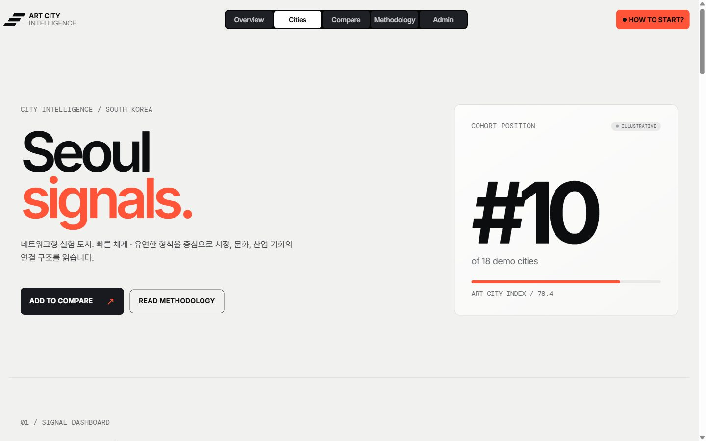
  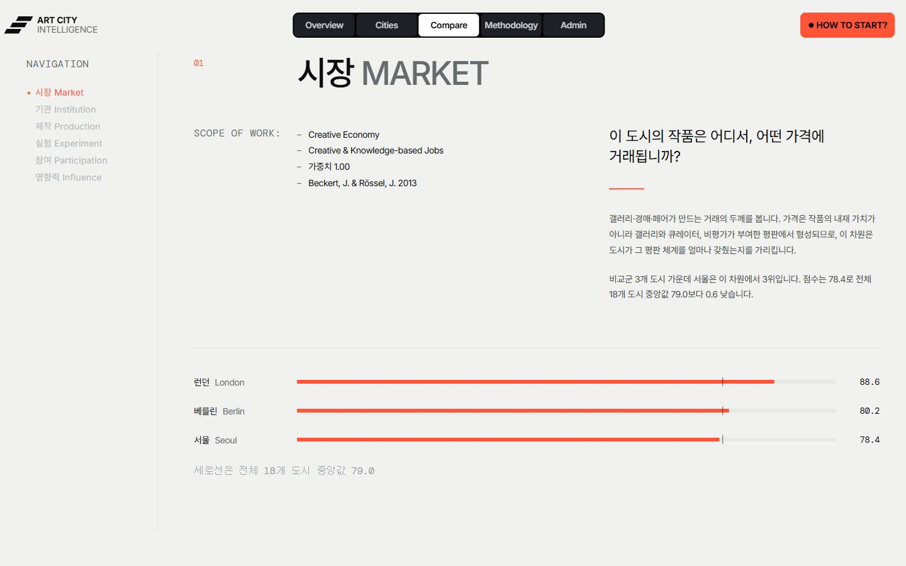
</p>

- 신호 대시보드 → 관측 순위(가장 앞선 축·가장 뒤처진 축) → 6개 차원 → 추세 → 유사 도시 순서
- 도시 유형·DNA, 위치·유산·변화 수용성·전망, 연계 산업과 기회 제안, 도시를 대표하는 작품
- 비교 `/compare`: 차원을 고르면 도시 점수와 18개 도시 중앙값의 차이를 문장과 막대로 보여 줌

<details>
<summary>서울 상세 전체 화면</summary>

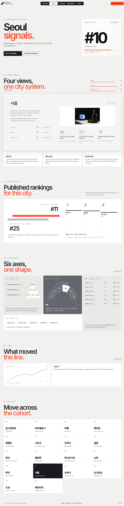
</details>

### 📖 방법론 · 🛠️ 관리자

<p align="center">
  
  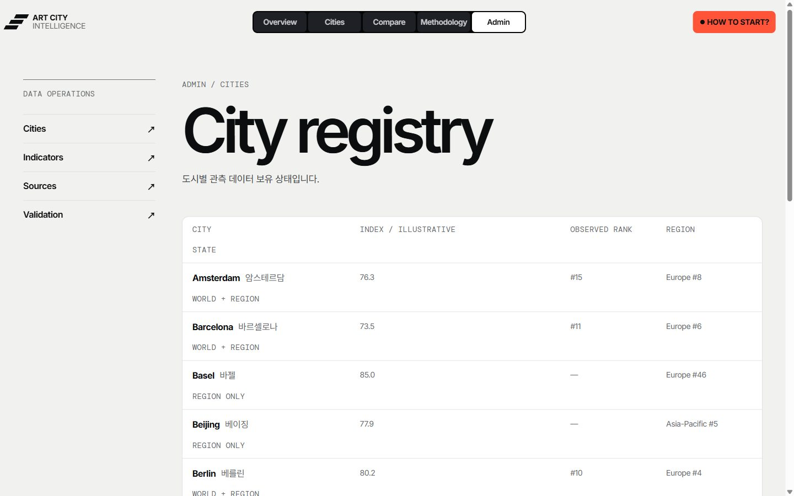
</p>

- 방법론: 두 종류의 숫자, 차원과 근거 문헌 대응표, 처리 단계, 알려진 한계, 문헌 13건
- 관리자: 도시별 관측 데이터 보유 상태(세계+권역 / 권역만), 지표·출처·검증 목록 (읽기 전용, Basic 인증)

<a id="details"></a>
## 🧩 7. 기능별 핵심 특징과 구현 상세

| 기능 | 핵심 특징 | 구현 상세 |
| --- | --- | --- |
| 🌐 지구본 | 드래그 회전, 도시 마커·툴팁, 검색, Ctrl/⌘ + 휠·핀치 확대 (일반 휠은 페이지 스크롤) | `components/globe/ArtGlobe.tsx` `GlobeInteraction.tsx` · Canvas, 육지 경계는 `scripts/build-land-polygons.mjs`가 Natural Earth 110m TopoJSON을 `public/textures/land-polygons.json`으로 변환 |
| 📊 6개 차원 점수 | 차원별 점수와 ± 민감도 | `features/comparison/service.ts` · `DIMENSIONS`(C3 하위지수·근거 문헌·가중치), `getCityIndicators` |
| ⚖️ 중앙값 비교 | 18개 도시 중앙값 대비 차이 | `getCohortMedians` `getIndexMedian` · `components/charts/CompareExplorer.tsx` |
| 🛰️ 관측 순위 | 세계·권역 순위와 세 축, 앞선·뒤처진 축 | `features/evidence/observed.ts` · `ObservedPositionBoard.tsx` |
| 🏷️ 출처 상태 배지 | OBSERVED / ILLUSTRATIVE 구분 | `types/provenance.ts` · `components/evidence/DataBadge.tsx` |
| 📚 문헌 대장 | 차원·화면마다 근거 문헌 연결 | `features/evidence/sources.ts` (`SourceId`, `citation`) |
| 🖼️ 대표작 | 도시별 작품의 의미·의도·도시와의 연결 | `SignatureWorkModal.tsx` · `SignatureWork` 타입 |
| 🔌 조회 API | 잘못된 주소 이름은 400, 없는 도시는 404 | `app/api/*/route.ts` · `parseCitySlug`, `lib/api/response.ts` |
| ✉️ 문의 | 빈 칸·이메일 형식 검사, HTML 이스케이프, 봇 차단 칸, 키가 없으면 503 | `app/api/contact/route.ts` · Resend API |
| 🔐 관리자 인증 | `/admin/*`만 Basic 인증, 환경 변수가 없으면 잠김 | `src/proxy.ts` · `ADMIN_USER` `ADMIN_PASSWORD` |
| 🇰🇷 한국어 조사 | 받침에 따라 은/는 · 이/가 · 을/를 자동 선택 | `lib/korean.ts` `withTopic` `withSubject` `withObject` |

<a id="decisions"></a>
## 💡 8. 기술적 의사결정

| 결정 항목 | 채택안 | 검토한 대안 | 이유 |
| --- | --- | --- | --- |
| 지표 체계 | EU C3 하위지수 아래 6개 차원 | 자체 지표를 새로 정의 | 국제 지표 체계에 기대야 차원 정의를 설명할 수 있음 |
| 비교 기준 | 18개 도시 중앙값 대비 | 절대값 순위 | 대도시가 총량에서 늘 유리한 문제를 줄임 |
| 불확실성 표시 | 가중치 ±10% 민감도 | 대규모 시뮬레이션 | C3 통계 감사에서 가중치가 가장 큰 불확실성 원인. 범위를 줄이면서 같은 질문에 답함 |
| 숫자의 종류 | 관측값과 예시값을 배지로 분리 | 하나의 점수로 통합 | 실측 순위는 Resonance 하나뿐이라, 섞으면 예시 점수가 실측처럼 읽힘 |
| 시각화 | SVG·Canvas 직접 구현 | 차트·지도 라이브러리 | 지구본과 레이더의 형태를 디자인에 맞추고 의존성을 줄임 |
| 데이터 저장 | TypeScript 모듈 | DB | 도시 18개 규모는 코드에 두고 타입으로 검사하는 편이 빠름 |
| 관리자 보호 | Proxy Basic 인증 (환경 변수 계정 하나) | 회원 DB·OAuth | 관리자 화면이 읽기 전용이라 계정 하나로 충분. 편집 기능이 생기면 계정 체계로 옮김 |
| 미완성 화면 | 삭제 | '예시' 표시를 붙여 유지 | 진행률·갱신 시각 같은 가짜 상태가 실제 데이터처럼 읽힘 |
| 제작 방식 | 기획·조사·설계는 직접, 구현은 AI 코딩 도구 후 검수 | 전부 직접 구현 | 1인 프로젝트에서 조사와 설계에 시간을 씀 |

<a id="structure"></a>
## 📂 9. 주요 폴더 구조와 데이터 모델

```text
art-city-intelligence/
├─ src/
│  ├─ proxy.ts                     # /admin/* Basic 인증
│  ├─ app/
│  │  ├─ (public)/                 # overview · cities/[citySlug] · compare · methodology
│  │  ├─ (admin)/admin/            # cities · indicators · sources · validation
│  │  └─ api/                      # cities · indicators · cultural · market · contact
│  ├─ features/
│  │  ├─ city-intelligence/        # 도시 18개 데이터 · 주소 이름 검사
│  │  ├─ comparison/               # 6개 차원 · 중앙값 · 민감도
│  │  ├─ evidence/                 # observed(관측 순위) · sources(문헌 13건) · describe
│  │  ├─ cultural-intelligence/    # 기관·행사·키워드
│  │  └─ market-intelligence/      # 작가·가격대(참고)
│  ├─ components/
│  │  ├─ globe/                    # 지구본 · 마커 · 툴팁
│  │  ├─ charts/                   # 레이더 · 막대 · 추세 · 비교
│  │  ├─ city/                     # 대시보드 · 관측 순위 · 신호 타일 · 대표작 모달
│  │  └─ evidence/ · market/ · cultural/ · layout/ · ui/
│  ├─ types/                       # city · indicator · provenance · market · cultural
│  ├─ lib/                         # api 응답 · 쿼리 검사 · 형식 · 한국어 조사(은/는·이/가·을/를)
│  ├─ img/                         # 도시별 대표작 이미지
│  └─ report/                      # 근거 문헌 PDF
├─ scripts/build-land-polygons.mjs # 지구본 육지 경계 생성
├─ public/textures/land-polygons.json
└─ docs/
   ├─ art-city-intelligence_slides.html  # 슬라이드 20장
   ├─ slides/                     # 슬라이드 이미지
   └─ screenshots/
```


<a id="run"></a>
## 🚀 10. 실행 방법

### 💻 방법 1. 내 컴퓨터에서 실행

Node.js 20 이상이 필요합니다.

```bash
git clone https://github.com/beang66/art-city-intelligence.git
cd art-city-intelligence
npm install
npm run dev          # http://localhost:3000
npm run typecheck    # 라우트 타입 생성 + tsc
npm run build
```

| 환경 변수 | 필수 | 설명 | 없을 때 동작 |
| --- | --- | --- | --- |
| `RESEND_API_KEY` | 문의 메일을 쓸 때 | Resend API 키 | 문의 전송 시 503 안내, 나머지 화면은 그대로 |
| `CONTACT_FROM_EMAIL` | 문의 메일을 쓸 때 | 인증한 도메인의 보내는 주소 | 위와 같음 |
| `ADMIN_USER` · `ADMIN_PASSWORD` | 관리자 화면을 쓸 때 | 관리자 Basic 인증 계정 | `/admin/*`가 401로 잠김 |

### ☁️ 방법 2. Vercel로 배포

1. Vercel에서 저장소를 가져오기 (Framework Preset: Next.js, 루트 폴더 그대로)
2. Environment Variables에 위 네 값을 입력
3. `main`에 푸시하면 [art-city-intelligence.vercel.app](https://art-city-intelligence.vercel.app/)에 배포

<a id="verify"></a>
## ✅ 11. 검증 결과

기준일 2026.11.19 · Next.js 16.4.6 · 로컬 프로덕션 서버(`next start`)

| 항목 | 방법 | 결과 |
| --- | --- | --- |
| 타입 검사 | `npm run typecheck` (`next typegen && tsc --noEmit`) | 통과 |
| 프로덕션 빌드 | `npm run build` | 성공, 정적 페이지 33개 (도시 상세 18개 포함) · Proxy 1개 |
| 관리자 인증 | `/admin/cities` 요청 3회 | 인증 없음 401 · 틀린 비밀번호 401 · 맞는 비밀번호 200 |
| 조회 API | `GET /api/indicators?city=seoul` | 200 |
| 화면 | 1440px에서 개요·서울 상세·비교·방법론·관리자 열기 | 다섯 화면 표시, 서울 문장 '유연한 형식을' 확인, 개요에 '40개' 문구 없음 |
| 의존성 보안 | `npm audit --omit=dev` | 0건 (이전 critical 1 · high 2) |
| 확인하지 않은 범위 | — | 모바일 화면, 문의 메일 실제 발송, Vercel에 관리자 환경 변수를 넣은 뒤의 배포본 |

<a id="retro"></a>
## 📈 12. 회고

### 🔧 코드 검토로 해결한 문제

| 문제 | 원인 | 해결 |
| --- | --- | --- |
| README와 슬라이드가 예시 점수를 실측처럼 서술 | 관측값과 예시값을 문서에서 나누지 않음 | 문서를 코드에 맞춰 다시 쓰고, 화면과 같은 [해석 원칙](#interpret) 표를 둠 |
| 작업 공간 카드에 '72% 진행', '12분 전 갱신', 데이터에 없는 리스본·밀라노 | 연결되지 않은 예시 화면 | 섹션 삭제, 'AI가 만든 문장' 문구를 실제 기능에 맞춤, '40개 후보 도시' → 18개 |
| EN을 눌러도 언어가 바뀌지 않음 | 동작이 없는 언어 메뉴 | 메뉴와 스타일 삭제 (−44줄) |
| 관리자 화면을 누구나 열 수 있음 | 인증 없음 | `src/proxy.ts` Basic 인증, 환경 변수가 없으면 잠김 |
| `npm audit` critical 1 · high 2 | `next` 16.3.5가 취약 범위, `sharp`·`source-map-js` | `next` 16.4.6 · `npm audit fix` → 0건 |
| 서울 상세 문장이 '유연한 형식를' | 조사를 '를'로 고정 | `withObject()`로 받침에 맞춰 을/를 |
| 지구본 위에서 휠을 굴리면 페이지가 내려가지 않음 | 휠 이벤트를 늘 막고 확대로 씀 | Ctrl/⌘ + 휠과 핀치만 확대 |
| 중앙값 계산이 세 곳에 복사됨 | 함수마다 같은 코드 | `median()` 하나로 합침 |

### ⚠️ 남은 중요한 문제

| 순서 | 문제 | 왜 중요한가 | 다음 행동 |
| :---: | --- | --- | --- |
| 1 | 6개 차원 점수가 `지수 × 고정 가중치` | 모든 도시에서 실험 > 시장 > 영향력 순서가 같아, '순위 하나는 강점의 조합을 숨긴다'는 기획 질문에 답하지 못함 | 로드맵 1: '기관' 차원부터 도시별 문화 시설 수(인구 대비)로 교체 |
| 2 | 관측 순위를 PDF에서 코드로 손으로 옮김 | 원자료 파일·수집일이 없어 값을 다시 만들거나 대조할 수 없음 | CSV 원자료 + 변환 스크립트 + 화면 값 대조 테스트 |
| 3 | 공개 저장소에 보고서 PDF 13개(약 100MB, 단행본 포함)와 작품 이미지 20점 | 발행 기관·작가에 권리가 있는 자료를 그대로 배포 | PDF는 저장소에서 빼고 링크로, 작품 이미지는 이용 허락 확인 또는 교체 |
| 4 | 자동 테스트 없음 | 중앙값·순위 계산, API 상태 코드, 인증이 사람의 확인에만 기댐 | 계산 함수와 Proxy에 테스트, CI에서 테스트·`npm audit` 실행 |

| Keep | Problem | Try |
| --- | --- | --- |
| 차원마다 근거 문헌을 붙이고 관측값과 예시값을 배지로 나눠, 숫자의 출처를 화면에서 바로 확인하게 함 | 차원 점수가 지수의 배수라 비교 화면이 도시마다 같은 모양 | 실측 지표 하나를 끝까지 연결한 뒤 화면을 늘림 |
| 40개 도시·대규모 시뮬레이션을 18개 도시·민감도로 줄여 끝까지 배포 | 연결되지 않은 화면을 오래 둠 | 동작하지 않는 화면은 만들지 않거나 바로 지움 |

<a id="roadmap"></a>
## 🗺️ 13. 로드맵

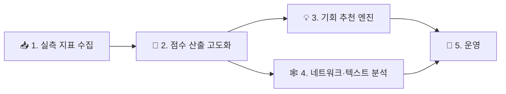

| 단계 | 할 일 | 필요한 데이터·작업 | 완료 기준 |
| --- | --- | --- | --- |
| 📥 1. 실측 지표 수집 | '기관' 차원부터 6개 차원 예시 점수를 공개 지표로 교체, 원자료는 CSV로 | C3 지표 정의에 맞춘 도시별 기관 수·창조 일자리·행사·국제 연결 데이터, 수집일·출처 기록, 변환 스크립트 | 교체한 차원에 `OBSERVED` 배지, 도시마다 차원 모양이 달라짐, 원자료와 화면 값 대조 테스트 통과 |
| 🧮 2. 점수 산출 고도화 | 규모와 밀도 분리, 이상치에 강한 표준화 | 인구 대비 지표, Robust Z-score, 결측 처리 | 점수마다 계산식과 원자료로 되짚어 감 |
| 💡 3. 기회 추천 엔진 | 사업 조건 입력 → 규칙 기반 도시·형식 추천, 근거 문장은 LLM이 설명 | 산업·공간 형식별 규칙 표, 근거 차원 연결 | 추천마다 근거 차원과 출처가 함께 표시 |
| 🕸️ 4. 네트워크·텍스트 분석 | 기관·작가·행사 관계망, 비평·보도 텍스트에서 도시 키워드 | 관계 데이터, 텍스트 말뭉치 | 도시 DNA 문구를 분석 결과로 대체 |
| 🔐 5. 운영 | 데이터 갱신 화면, 계정 체계, 자동 점검 | 갱신 이력, 테스트, CI | 갱신마다 이력이 남고, CI에서 테스트·`npm audit` 통과 |

<a id="slides"></a>
## 🎞️ 14. 슬라이드

문제 → 해결 설계 → 화면 → 기술과 검증 → 다음 단계 순서로 만든 HTML 슬라이드 20장(본문 18 · 부록 2, 약 13분)입니다. 저장소를 받아 `docs/art-city-intelligence_slides.html`을 브라우저로 열면 목차(T), 발표자 노트(P), 전체 화면(F), 화면 확대를 쓸 수 있습니다.

<details open>
<summary>슬라이드 20장 보기</summary>

<p align="center">
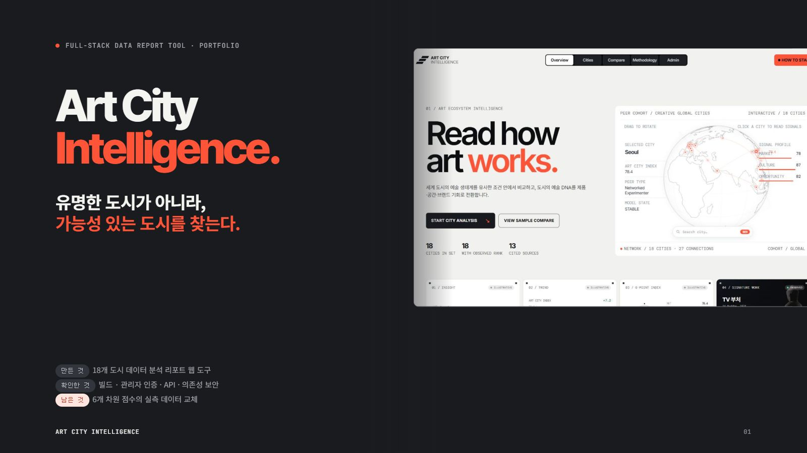
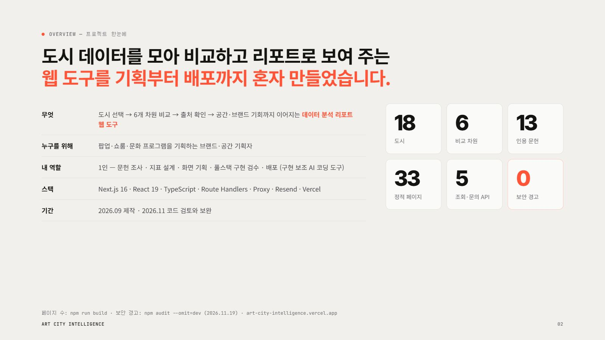

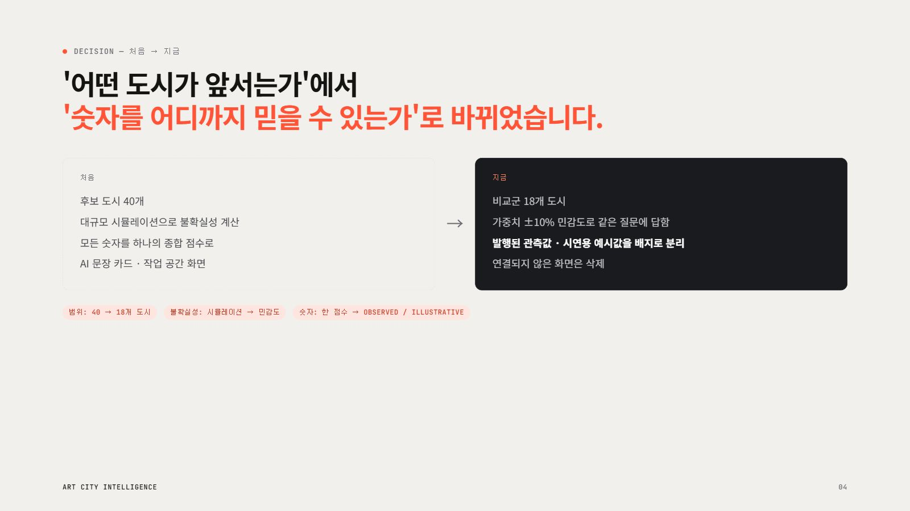
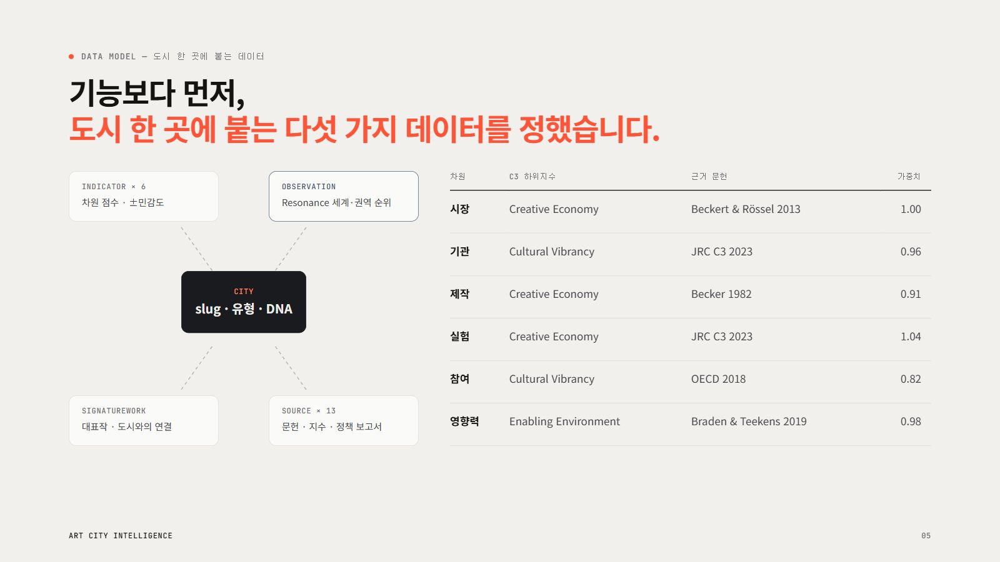


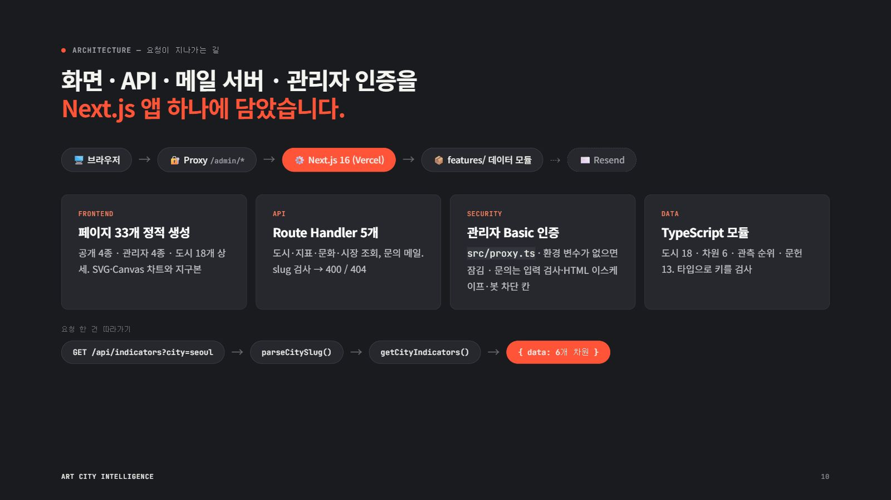


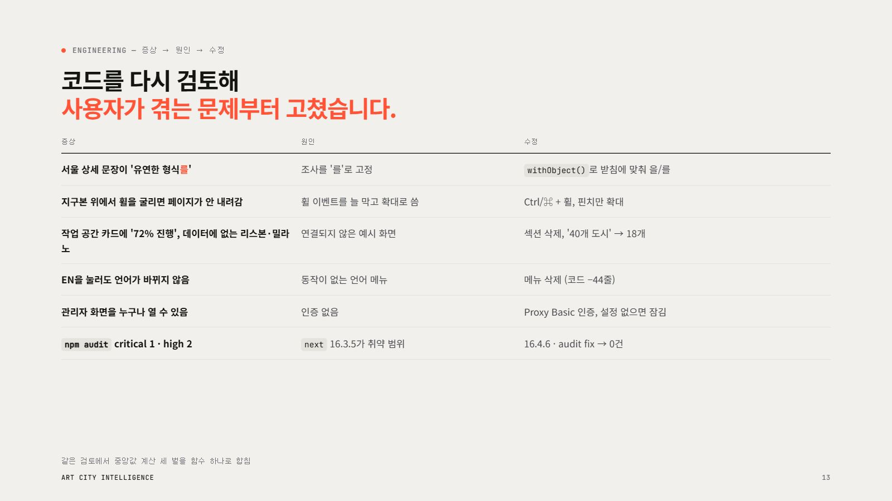


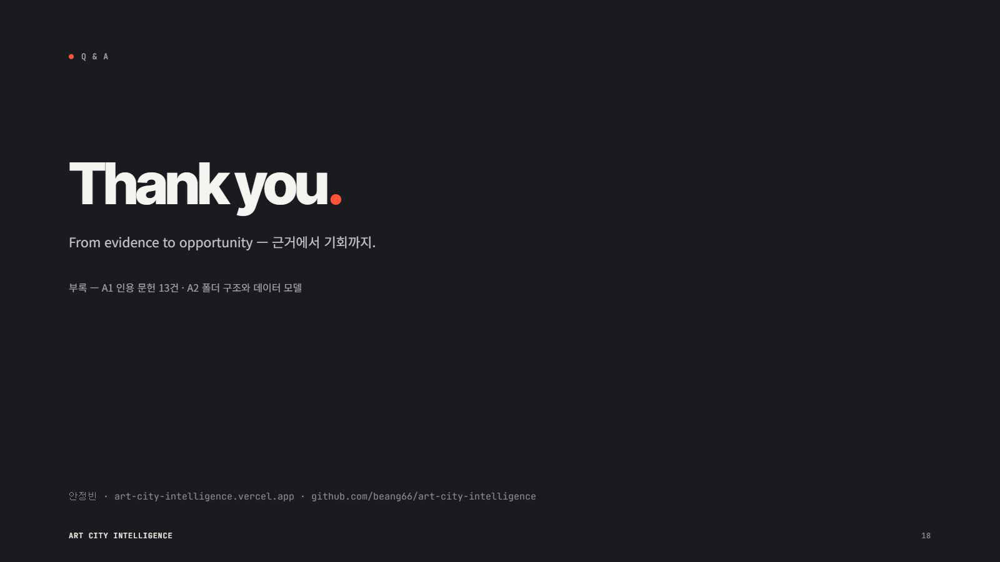
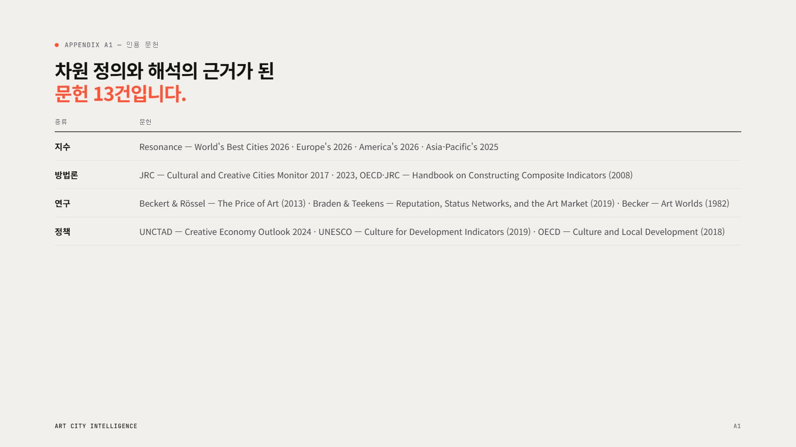
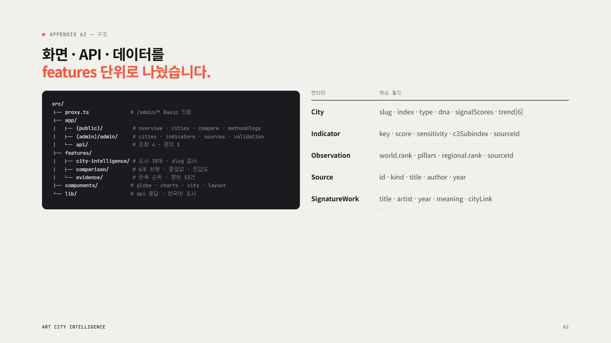
</p>
</details>

<a id="license"></a>
## 📄 15. 라이선스와 자료 권리

개인 포트폴리오 프로젝트로, 오픈소스 라이선스를 두지 않았습니다. `src/img`의 작품 이미지는 각 작가와 소장처, `src/report`의 보고서는 각 발행 기관에 권리가 있습니다. 지구본 육지 경계는 Natural Earth(퍼블릭 도메인) 데이터를 썼습니다.

<div align="center">
<br>
<strong>🌍 Art City Intelligence</strong> · From evidence to opportunity<br>
안정빈
</div>
