# 🌍 Art City Intelligence

> **"유명한 도시가 아니라, 가능성 있는 도시를 찾는다."**

세계 18개 도시의 예술 생태계 데이터를 6개 차원으로 비교하고, 숫자의 출처와 공간·브랜드 기회까지 한 화면에서 읽는 **풀스택 데이터 분석 리포트 웹 도구**입니다.
세계 100개 도시 데이터로 **'경제 규모에 비해 문화적 끌림이 큰 도시'를 찾는 머신러닝 모델**을 학습하고(Google Colab), 팝업·비상설 전시·상설 전시 **형식별로 적합한 도시**를 Streamlit으로 보여 줍니다.
리포트 화면은 Next.js(Vercel), 계산과 API는 **FastAPI(Render)**, 데이터는 출처·필드 정의가 붙은 버전 JSON으로 나눴습니다.

<div align="center">

[](https://art-city-intelligence.vercel.app/)
[](https://art-city-intelligence.vercel.app/slides.html)
[](https://colab.research.google.com/github/beang66/art-city-intelligence/blob/main/ml/notebooks/art_city_opportunity_model.ipynb)
[](#data)


<br>

<a href="https://art-city-intelligence.vercel.app/">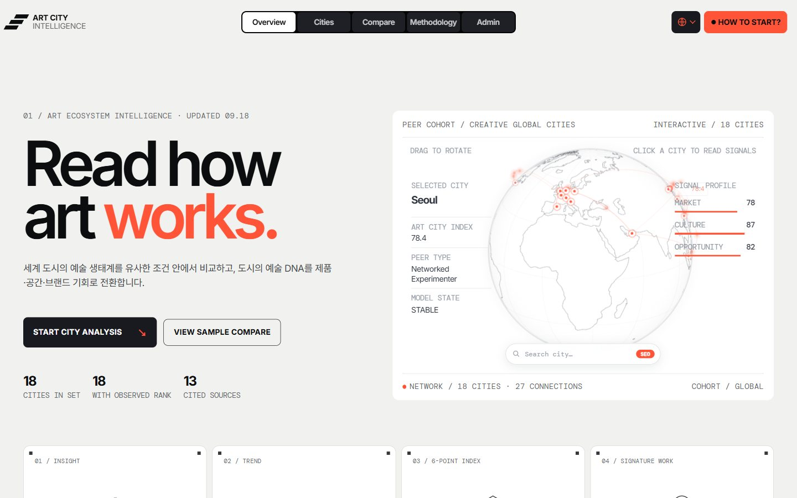</a>

</div>

**🗓️ 작업 기간** 2026.09 제작 · 2026.11 코드 검토와 보완 · **👤 역할** 문헌 조사·지표 설계·화면 기획·풀스택 구현 검수·배포 안정빈 (1인) / 구현 보조 AI 코딩 도구

### 🏆 핵심 성과

| 학습 데이터 | 모델 성능 (5겹 교차 검증) | 리포트 도시 | 화면 | FastAPI | 전환 검증 | 보안 경고 |
| :---: | :---: | :---: | :---: | :---: | :---: | :---: |
| **100개 도시** (Resonance 2026) | **R² 0.83 · Spearman 0.87** (평균 예측 대비 MAE −59%) | **18개** · 6개 차원 · 문헌 13건 | **9종** + Streamlit 6탭 | **7개** 엔드포인트 | **기존 API 93/93 일치** | **0건** |

### 🧱 풀스택 구성

| 계층 | 맡은 일 |
| --- | --- |
| 🖥️ 리포트 화면 | Next.js 16 — 개요·도시 상세·비교·기회 도시·방법론·관리자 9종, 도시 18곳 상세를 빌드할 때 미리 생성 |
| 🐍 계산 · API | FastAPI — 차원 점수·중앙값·신호 순위·순위 해석 계산, `GET /api/cities` · `indicators` · `cultural` · `market` · `meta`, `POST /api/contact`, `GET /health` |
| 📦 데이터 | `backend/data/*_v1.json` — 도시·차원·관측 순위·문헌 + `provenance_v1.json`(숫자마다 할 수 있는 말)·`field_dictionary_v1.json` |
| 🔁 화면과 API 일치 | `export_snapshot.py`가 API와 같은 함수로 `src/data/snapshot_v1.json`을 만들고, `verify_backend.py`가 둘이 같은지 검사 |
| 🌐 모델을 쓰는 화면 | 도시 상세 '05 / OPPORTUNITY MODEL'(기회 점수·기대 vs 실제·도시 유형·형식별 적합도·비슷한 도시), `/opportunity`(형식별 상위 15개 + What-if 예측) |
| 🤖 모델 | Colab 노트북 — scikit-learn(Ridge·랜덤 포레스트·그래디언트 부스팅)·PyTorch MLP 비교, KMeans 도시 유형, 다국어 문장 임베딩, joblib 저장 |
| 📊 Streamlit | 형식별 추천(팝업·비상설·상설) · 기회 도시 순위 · 기대 vs 실제 · 도시 유형 지도 · 비슷한 도시 · What-if 예측 (Plotly) |
| 🔐 보안 | `src/proxy.ts`가 `/admin/*`에 Basic 인증, 설정이 없으면 잠김 · 문의 입력 검사·HTML 이스케이프·봇 차단 칸 |
| ☁️ 배포 | Vercel(화면) + Render(FastAPI) + Streamlit Community Cloud(모델), Vercel이 `/api/*`를 Render로 넘김 |

### ✨ 핵심 기능

| 🌐 탐색 | 📊 비교 | 🔎 출처 추적 | 💡 기회 |
| :---: | :---: | :---: | :---: |
| **지구본에서 도시 고르기** | **중앙값 대비로 읽기** | **관측값과 예시값 분리** | **도시별 공간·브랜드 제안** |
| 드래그 회전·도시 검색<br>신호 타일 4개<br>비교군 18개 도시 | 6개 차원 막대·레이더<br>가중치 ±10% 민감도<br>유사 도시 | 발행 순위 따로 표시<br>차원별 근거 문헌<br>OBSERVED·ILLUSTRATIVE 배지 | 도시 유형·DNA<br>연계 산업<br>제안 이유 한 문장 |

---

## 📑 목차

1. [🗂️ 개요](#overview)
2. [🎯 기획 배경](#background)
3. [🏗️ 시스템 아키텍처와 데이터 흐름](#architecture)
4. [📊 데이터 출처와 지표 정의](#data)
5. [⚖️ 해석 원칙](#interpret)
6. [🤖 기회 도시 모델 — 머신러닝·딥러닝](#model)
7. [✨ 주요 화면](#screens)
8. [🧩 기능별 핵심 특징과 구현 상세](#details)
9. [💡 기술적 의사결정](#decisions)
10. [📂 주요 폴더 구조와 데이터 모델](#structure)
11. [🚀 실행 방법](#run)
12. [✅ 검증 결과](#verify)
13. [📈 회고](#retro)
14. [🗺️ 로드맵](#roadmap)
15. [🎞️ 슬라이드](#slides)
16. [📄 라이선스와 자료 권리](#license)

---

<a id="overview"></a>
## 🗂️ 1. 개요

| 항목 | 내용 |
| --- | --- |
| 목표 | 도시의 예술 생태계를 하나의 순위가 아니라 여러 차원의 조합으로 읽고, 공간·브랜드 기회로 연결한다 |
| 원칙 | 규모와 밀도를 나눠 본다 · 비슷한 조건의 도시끼리 비교한다 · 발행된 관측값과 시연용 예시값을 섞지 않는다 |
| 대상 | 팝업·쇼룸·문화 프로그램을 기획하는 브랜드·공간 기획자 |
| 도시 | 서울, 베를린, 런던, 뉴욕, 멕시코시티, 멜버른, 암스테르담, 베이징, 바르셀로나, 시카고, 두바이, 홍콩, 파리, 베네치아, 바젤, 도쿄, 상하이, 싱가포르 (18개) |
| 기간 | 2026.09 |
| 역할 | 문헌 조사·지표 설계·화면 기획·풀스택 구현 검수·배포: 안정빈 (개인) / 구현 보조: AI 코딩 도구 |
| 형태 | 풀스택 웹 앱 — Next.js 리포트 화면(Vercel) + FastAPI 계산·API(Render) + 버전 JSON 데이터 |

<a id="background"></a>
## 🎯 2. 기획 배경

### 💼 해결하는 비즈니스 문제

| 항목 | 내용 |
| --- | --- |
| 고객 | 해외에서 팝업·비상설 전시(기획전)·상설 전시(상설관·쇼룸)를 여는 브랜드(가구·패션·호텔)와 전시·공간 기획사 |
| 결정 | "다음 해외 공간을 **어느 도시에**, **어떤 형식**(팝업 · 비상설 전시 · 상설 전시)으로 열 것인가" |
| 지금 방식 | 유명도와 담당자 감으로 도시를 고름 → 이미 비싸고 경쟁이 꽉 찬 대도시로 쏠림. 근거를 모으는 데 몇 주가 걸리고, 결과를 기록하지 않아 다음 결정이 배우지 못함 |
| 핵심 문제 | 임차·시공·운영 고정비가 큰 투자에서 **잘못된 도시·형식을 고를 위험과 조사 시간**을 줄이기. 형식마다 필요한 조건이 다름 — 팝업은 짧은 기간의 유동·화제성, 비상설 전시는 문화 관객층, 상설 전시는 거주자·구매력·운영 안정성 |
| 해결 | ① 100개 도시에서 **경제·정주 여건으로 기대되는 것보다 문화 매력이 앞선 도시**를 모델로 찾음 ② 형식별 조건을 가중치로 반영한 **형식 적합도**로 후보를 정렬 ③ 비슷한 도시·도시 유형으로 후보를 넓힘 ④ 18개 도시 리포트에서 근거와 출처를 확인 |
| 성공 지표 (측정 전 목표) | 후보 조사 시간 · 추린 후보 안에 실제 선택 도시가 들어가는 비율 · 형식별 성과(팝업: 방문·매출 / 비상설 전시: 관람객·체류 시간 / 상설 전시: 월 방문·재방문·매출)와 적합도의 상관 |

| 문제 | 왜 문제인가 | 해결 |
| --- | --- | --- |
| 문화도시 지표는 '유명한 도시'를 보여 준다 | 브랜드·공간 기획자가 찾는 것은 아직 덜 알려졌지만 조건이 맞는 도시 | 도시 유형·DNA·연계 산업·기회 제안을 도시마다 함께 보여 줌 |
| 대도시가 절대량에서 유리하다 | 기관 수·거래액 같은 총량은 인구가 많은 도시를 늘 위에 올림 | 18개 도시 중앙값과의 차이로 비교 |
| 단일 순위는 강점의 조합을 설명하지 못한다 | 시장은 약해도 제작·실험이 강한 도시가 묻힘 | EU 문화·창조도시 모니터 체계를 따른 6개 차원으로 분해 |
| 데이터와 근거가 흩어져 있다 | 숫자가 어디서 왔는지 알 수 없으면 의사결정에 못 씀 | 차원마다 근거 문헌, 발행 순위는 출처와 함께 따로 표시 |

| 단계 | 결정 |
| --- | --- |
| 문헌 조사 | UNESCO, EU Cultural and Creative Cities Monitor, OECD 문화·지역발전 문헌을 읽고 '규모와 밀도 분리', '유사 도시끼리 비교' 원칙을 세움 |
| 기획 전환 | '어떤 도시가 앞서는가'에서 '내 조건에 맞는 공간 전략은'으로. 도시 선택 → 유사 도시 비교 → 공간·브랜드 제안 흐름 |
| 범위 조정 | 40개 후보 도시 → 18개, 대규모 시뮬레이션 대신 가중치 ±10% 민감도, 네트워크·텍스트 분석은 다음 단계로 |
| 구현 | 개요·도시 상세·비교·방법론·관리자 화면을 만들고 배포 |
| 검토·보완 | 코드 검토로 조사 오류·스크롤 막힘·연결되지 않은 화면·관리자 접근·의존성 경고를 고침 ([회고](#retro)) |

<a id="architecture"></a>
## 🏗️ 3. 시스템 아키텍처와 데이터 흐름

### 🧱 기술 스택

| 계층 | 기술 | 이 프로젝트에서 맡은 일 |
| --- | --- | --- |
| Frontend | Next.js 16 (App Router), React 19, TypeScript strict | 공개·관리자 화면, 도시 18개 상세를 미리 생성, `/api/*`를 FastAPI로 넘김 |
| 시각화 | SVG · Canvas 직접 구현, `topojson-client` | 지구본(Natural Earth 110m 육지 경계), 레이더·막대·추세 차트 |
| Backend | FastAPI, Uvicorn, Python 3.12 | 조회·메타·문의 API, 점수·중앙값·신호 순위·순위 해석 계산 |
| 데이터 | 버전 JSON (`backend/data/*_v1.json`) | 도시 18개, 6개 차원, 관측 순위, 문헌 13건, 출처 규칙, 필드 정의 |
| 보안 | Next.js Proxy (`src/proxy.ts`) | `/admin/*` Basic 인증, 환경 변수가 없으면 잠김 |
| 외부 서비스·배포 | Resend, Vercel, Render | 문의 메일 발송, 화면 배포, FastAPI 배포 |

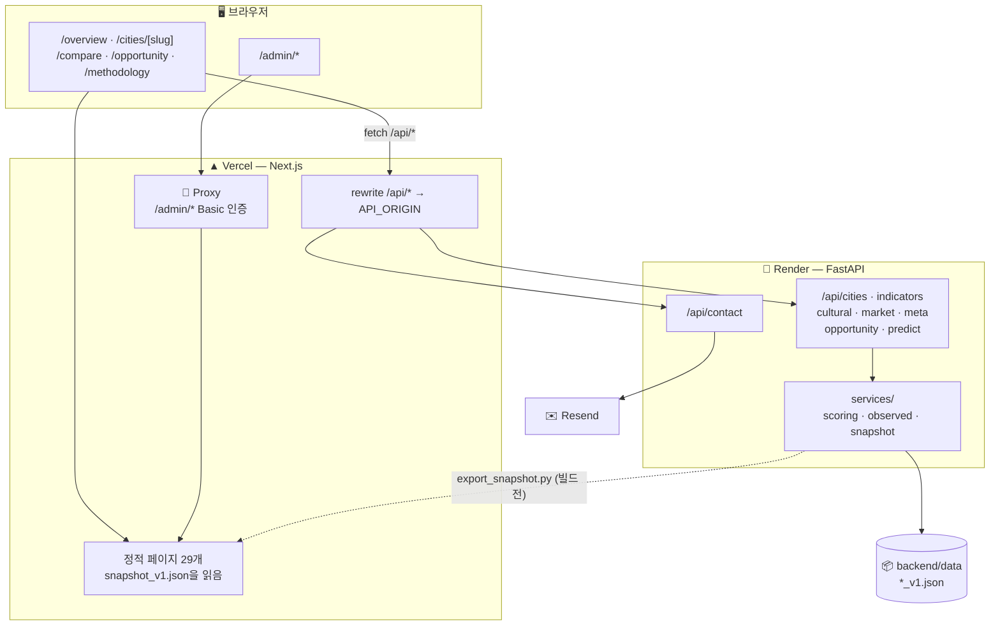

### 🔄 데이터 처리 흐름

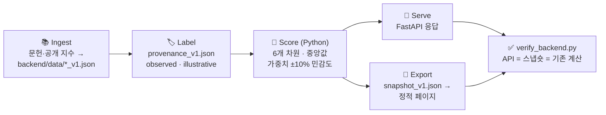

### 🧭 사용 흐름

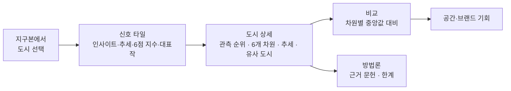

| API (FastAPI) | 입력 | 응답 |
| --- | --- | --- |
| `GET /health` | — | `{"status": "ok"}` (Render 상태 확인) |
| `GET /api/meta` | — | 도시·관측·문헌 수, 데이터 버전, 숫자마다 할 수 있는 말 / 없는 말 |
| `GET /api/cities` | `?slug=` (없으면 전체) | 도시 목록 또는 도시 한 곳 |
| `GET /api/indicators` | `?city=` | 6개 차원 점수·민감도·근거 문헌 |
| `GET /api/cultural` · `/api/market` | `?city=` | 기관·행사·키워드 / 작가·가격대(참고) |
| `GET /api/opportunity` | `?format=popup\|temporary\|permanent&limit=` | 형식별 적합도 순위 (100개 도시) |
| `POST /api/opportunity/predict` | 정주 여건·경제 활력 순위, 광역 인구, 권역 | joblib 모델이 계산한 기대 Lovability 순위. 범위 밖 입력은 400 |
| `POST /api/contact` | 이름·연락처·이메일 | Resend로 메일 발송, 빈 칸·이메일 형식 검사 (400), 키 없음 503, 발송 실패 502 |

<a id="data"></a>
## 📊 4. 데이터 출처와 지표 정의

### 📐 6개 차원

EU 공동연구센터의 Cultural and Creative Cities Monitor(C3, 2023)의 세 하위지수 아래에 차원을 두고, 차원마다 정의를 받친 연구를 하나씩 연결했습니다.

| 차원 | C3 하위지수 | C3 차원 | 근거 문헌 | 가중치 |
| --- | --- | --- | --- | :---: |
| 시장 Market | Creative Economy | Creative & Knowledge-based Jobs | Beckert & Rössel (2013) | 1.00 |
| 기관 Institution | Cultural Vibrancy | Cultural Venues & Facilities | JRC C3 (2023) | 0.96 |
| 제작 Production | Creative Economy | New Jobs in Creative Sectors | Becker (1982) | 0.91 |
| 실험 Experiment | Creative Economy | Intellectual Property & Innovation | JRC C3 (2023) | 1.04 |
| 참여 Participation | Cultural Vibrancy | Cultural Participation & Attractiveness | OECD (2018) | 0.82 |
| 영향력 Influence | Enabling Environment | Local & International Connections | Braden & Teekens (2019) | 0.98 |

### 🛰️ 관측 데이터

| 항목 | 내용 |
| --- | --- |
| 출처 | Resonance Best Cities — World 2026, Europe 2026, Americas 2026, Asia-Pacific 2025 |
| 단위 | 순위 (낮을수록 상위) — 종합 순위와 Livability · Lovability · Prosperity 세 축 |
| 구성 | 30개 카테고리 46개 지표, 균등 가중 |
| 대상 | 광역 인구 100만 명 이상. 바젤·베네치아는 권역 순위로만 관측 |

### 📚 인용 문헌 13건

| 종류 | 문헌 |
| --- | --- |
| 지수 | Resonance — World's Best Cities 2026, Europe's 2026, America's 2026, Asia-Pacific's 2025 |
| 방법론 | JRC — Cultural and Creative Cities Monitor 2017·2023, OECD·JRC — Handbook on Constructing Composite Indicators (2008) |
| 연구 | Beckert & Rössel — The Price of Art (2013), Braden & Teekens — Reputation, Status Networks, and the Art Market (2019), Becker — Art Worlds (1982) |
| 정책 | UNCTAD — Creative Economy Outlook 2024, UNESCO — Culture for Development Indicators (2019), OECD — Culture and Local Development (2018) |

<a id="interpret"></a>
## ⚖️ 5. 해석 원칙

화면의 숫자는 두 종류입니다. 화면에는 `OBSERVED`와 `ILLUSTRATIVE` 배지로 구분합니다.

| 숫자 | 종류 | 할 수 있는 말 | 할 수 없는 말 |
| --- | --- | --- | --- |
| Resonance 종합·권역 순위, 세 축 순위 | OBSERVED | "Resonance 2026 기준 런던은 세계 1위다" | 이 순위로 예술 시장 규모를 말하기 |
| Art City Index, 6개 차원 점수 | ILLUSTRATIVE | "이 화면에서 서울은 실험 차원이 중앙값보다 높게 표시된다" (구성 예시) | "서울의 실험 역량이 측정상 베를린보다 높다" |
| 추세(2000–2025), 신호 점수 | ILLUSTRATIVE | 화면 구성과 읽는 법의 예시 | 연도별 실제 변화 |
| 가격대·작가 | 참고(indicative) | 도시를 대표하는 작가와 대략의 가격대 예시 | 시장 가격 산정 근거 |
| 공간·브랜드 기회 문구 | 제안 | 도시 특성에서 나온 기획 가설 | 수요가 검증된 사업 기회 |
| 가중치 ± 값 | 민감도 | 가중치를 ±10% 바꿀 때 점수가 움직이는 폭 | 측정 오차 |

알려진 한계 — 가중치를 정하는 방식이 순위를 가장 크게 흔들고, 문화 활력은 창조경제·기반환경과 상관이 낮아 하나로 합산하기 어렵고, 기준 연도마다 산출 방식이 달라 연도 간 순위를 직접 비교할 수 없습니다.

<a id="model"></a>
## 🤖 6. 기회 도시 모델 — 머신러닝·딥러닝

> **질문을 모델로:** "유명한 도시가 아니라 가능성 있는 도시" = 경제 활력·정주 여건·인구로 **기대되는 문화 매력 순위**보다 **실제 순위가 앞선** 도시.

### 📥 데이터

| 항목 | 내용 |
| --- | --- |
| 출처 | Resonance *World's Best Cities 2026* 요약표(p.58–61)와 도시별 페이지 |
| 규모 | 상위 100개 도시 × 세 축 순위(Livability · Lovability · Prosperity) · 광역 인구 · 강점 카테고리 2개 · 도시 소개 글 |
| 추출 | `ml/scripts/extract_resonance.py` (pdfplumber, 3단 페이지는 열 경계를 찾아 자름) → `ml/data/world_cities_2026.csv`. 표 순위 1–100과 도시 페이지 100개가 모두 맞는지 assert로 확인 |
| 권리 | 소개 글 원문은 Resonance 저작물이라 `ml/data/private/`(git 제외)에만 두고, 저장소에는 순위·인구 같은 사실값과 임베딩 결과(도시 이름·유사도)만 올림 |

### 🧮 방법

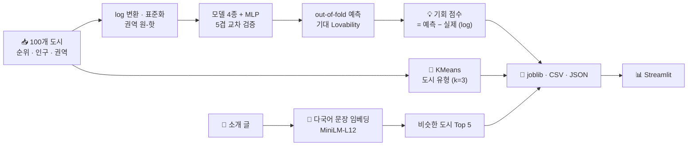

| 단계 | 내용 |
| --- | --- |
| 타깃 | `log(Lovability 순위)` — 문화·식음·야간·명소·SNS로 만든 '머무르고 싶은 매력' |
| 입력 | `log(Livability)`, `log(Prosperity)`, `log(인구)`, 권역. 강점 카테고리는 Lovability 구성 항목과 겹칠 수 있어 회귀 입력에서 뺌(누수 방지) |
| 검증 | 5겹 교차 검증(seed 42). 기회 점수는 그 도시를 학습에 쓰지 않은 out-of-fold 예측으로 계산 |
| 딥러닝 | ① PyTorch MLP(16 유닛, AdamW)를 같은 교차 검증으로 비교 ② `paraphrase-multilingual-MiniLM-L12-v2`로 소개 글을 384차원 벡터로 바꿔 코사인 유사도 Top 5 |
| 서빙 | 최종 모델을 전체 데이터로 다시 학습해 `ml/models/lovability_model.joblib`, 군집은 `city_clusters.joblib`, 점수표는 `ml/data/city_scores_2026.csv` |

### 📊 결과

| 모델 | MAE (log 순위) | R² | Spearman ρ |
| --- | :---: | :---: | :---: |
| 평균 예측 (기준선) | 0.859 | −0.06 | — |
| Ridge | 0.375 | 0.80 | 0.86 |
| 랜덤 포레스트 | 0.360 | 0.82 | 0.88 |
| **그래디언트 부스팅 (서빙)** | **0.350** | **0.83** | **0.87** |
| MLP (PyTorch) | 0.343 | 0.82 | 0.87 |

<sub>5겹 교차 검증 · 100개 도시 · 2026.11.19 실행. MLP와 그래디언트 부스팅의 차이(MAE 0.007)는 교차 검증 잡음 수준이라, torch 없이 joblib 하나로 불러오는 그래디언트 부스팅을 서빙한다.</sub>

<p align="center">
  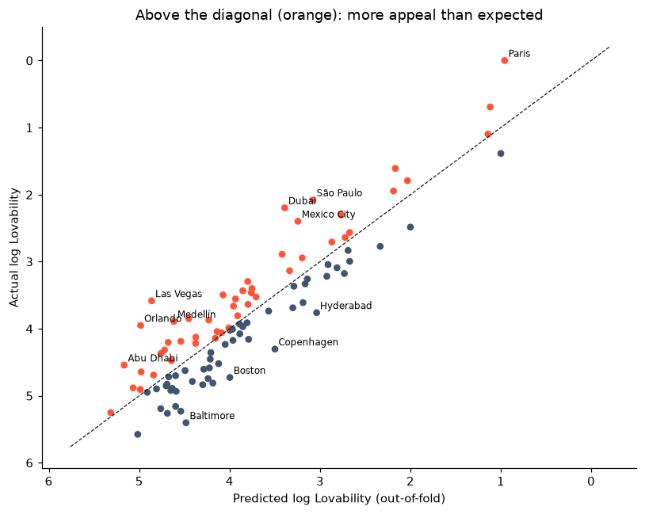
  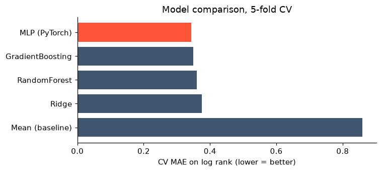
</p>

| 기회 점수 상위 | 실제 → 예측 Lovability | 읽는 법 |
| --- | --- | --- |
| 라스베이거스 · 두바이 · 올랜도 | 36 → 129 · 9 → 30 · 52 → 146 | 관광·엔터테인먼트 수요가 경제 규모보다 큼 |
| 상파울루 · 멕시코시티 · 메데인 | 8 → 22 · 11 → 26 · 49 → 101 | 중남미 대도시 — 문화 매력이 경제·정주 순위보다 앞섬 |
| 아테네 · 프라하 · 방콕 · 타이베이 | 47 → 86 · 33 → 59 · 18 → 31 · 67 → 108 | 중형 문화 도시 — 대도시보다 진입 부담이 작은 후보 |

| 리포트 18개 도시 | 기회 점수 | 소개 글이 비슷한 도시 (임베딩) |
| --- | :---: | --- |
| 멕시코시티 | +0.85 | 취리히 · 홍콩 · 코펜하겐 |
| 베를린 | +0.46 | 함부르크 · 루르 · 코펜하겐 |
| 서울 | −0.44 | 홍콩 · 부산 · 베이징 |
| 도쿄 | −0.39 | 오사카 · 헬싱키 · 케이프타운 |

- **도시 유형 (KMeans, 실루엣 0.37로 k=3):** 세 축 모두 상위인 글로벌 허브(런던·뉴욕·파리·도쿄) / 매력이 앞선 대도시(상파울루·홍콩·이스탄불·방콕) / 살기 좋은 중형 도시(멜버른·오슬로·스톡홀름·빈)
- **한계:** Lovability에 SNS·관광 지표가 들어 있어 관광 도시가 위로 올라온다 → Streamlit에서 강점 카테고리(Museums, Theaters & Concerts)로 거른다. 기회 점수는 '문화 매력이 기대보다 앞선 정도'이지 팝업 성과 예측이 아니며, 실제 팝업 결과로 검증해야 한다. 소개 글 임베딩은 보고서의 서술 주제(투자·인프라 등)를 함께 반영해 예술 씬의 유사도와는 다를 수 있다.

### 🎯 형식별 적합도 — 팝업 · 비상설 전시 · 상설 전시

같은 도시라도 형식에 따라 맞는 정도가 다릅니다. 구성 요소를 0–1로 맞춘 뒤 형식별 가중치로 더합니다(`ml/app/formats.py`).

| 형식 | 기간 | 중요한 조건 | 가중치 | 상위 도시 (100개 중) |
| --- | --- | --- | --- | --- |
| 🎪 팝업 | 며칠~몇 주 | 짧은 기간 유동·화제성 | 기회 점수 0.30 · 문화 매력 0.30 · 화제성 강점 0.25 · 인구 0.15 | 파리 · 상파울루 · 두바이 · 뉴욕 · 로마 |
| 🖼️ 비상설 전시 | 기획전 1~6개월 | 문화 관객층 | 문화 관객 강점 0.35 · 문화 매력 0.25 · 인구 0.25 · 기회 점수 0.15 | 파리 · 도쿄 · 멕시코시티 · 벵갈루루 · 델리 |
| 🏛️ 상설 전시 | 상설관·쇼룸 1년 이상 | 거주자·구매력·운영 안정성 | 정주 여건 0.30 · 경제 활력 0.30 · 생활·구매력 강점 0.20 · 문화 매력 0.10 · 기회 점수 0.10 | 런던 · 뉴욕 · 파리 · 싱가포르 · 바르셀로나 |

- **강점 신호:** 화제성(Instagram·TikTok·체크인·쇼핑·야간·명소·도보), 문화 관객(Museums·Theaters & Concerts·Sights & Landmarks·University), 생활·구매력(Standard of Living·대기업·경제 산출·교육 수준·컨벤션). 보고서는 도시마다 상위 강점 2개만 실어서, 해당이 없으면 0입니다.
- **같은 도시, 다른 답:** 멕시코시티는 비상설 전시 3위지만 상설 전시 67위, 서울은 비상설 전시 10위·상설 전시 27위·팝업 44위.
- **가중치는 설계 가정입니다.** 형식별 성과 데이터가 없어 학습한 값이 아닙니다. Streamlit에서 바꿔 볼 수 있고, 성과를 기록하면 이 값을 데이터로 맞춥니다(로드맵 3).

<p align="center">
  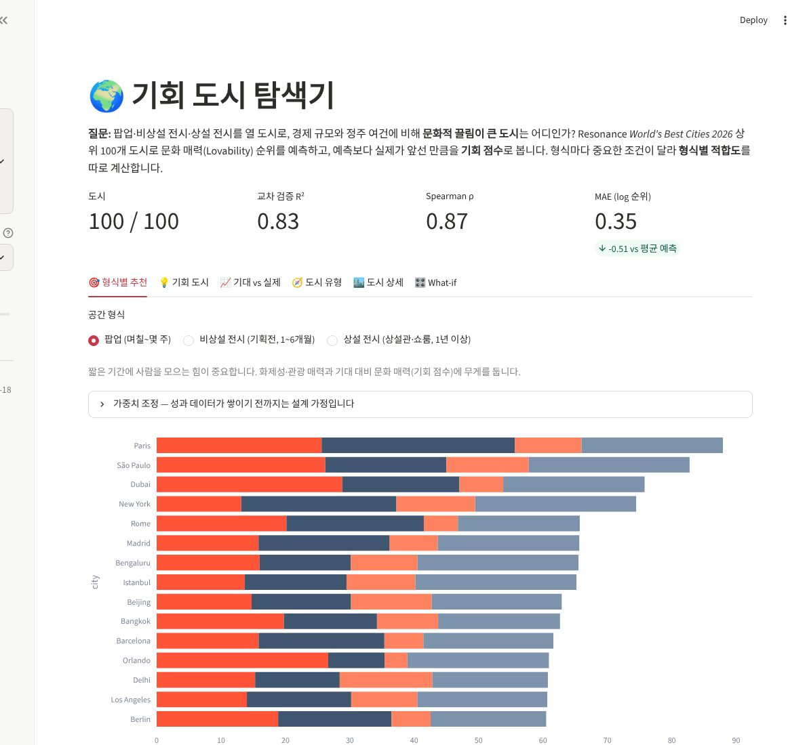
  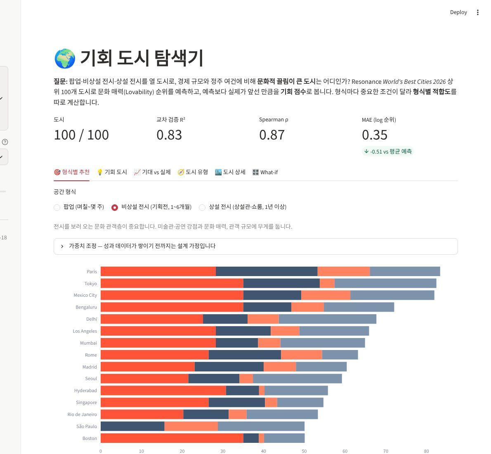
  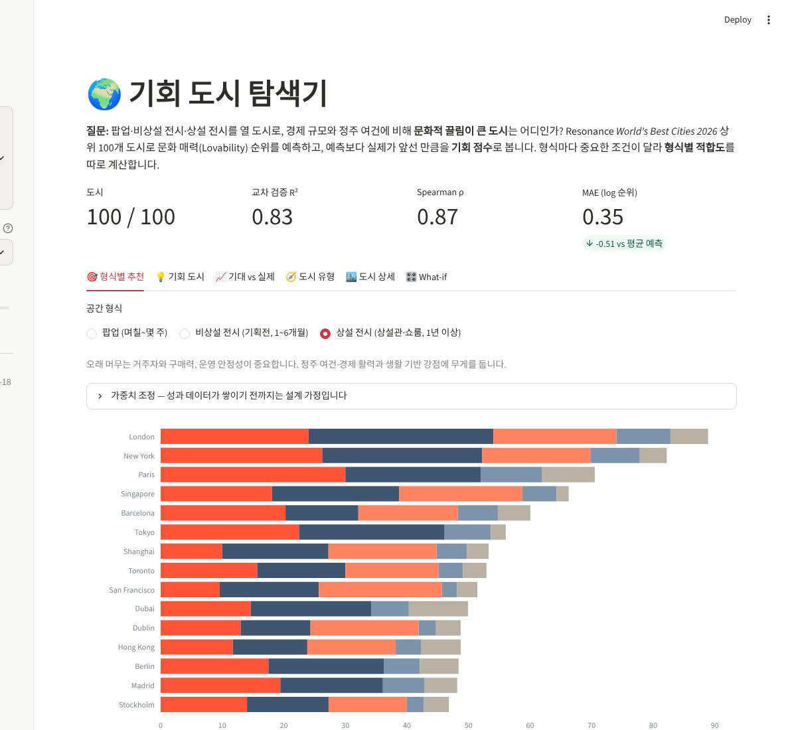
</p>

### 📊 Streamlit — 기회 도시 탐색기

<p align="center">
  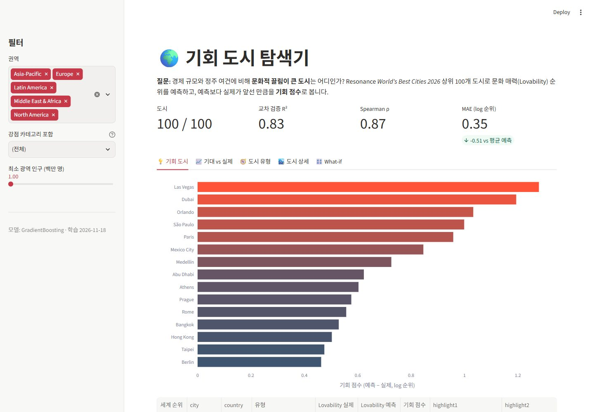
  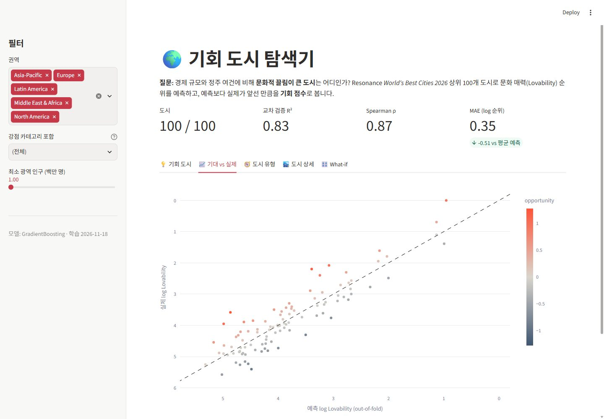
  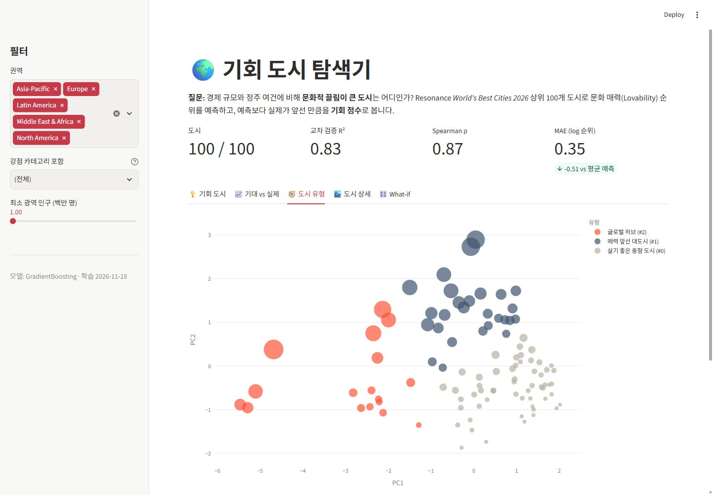
  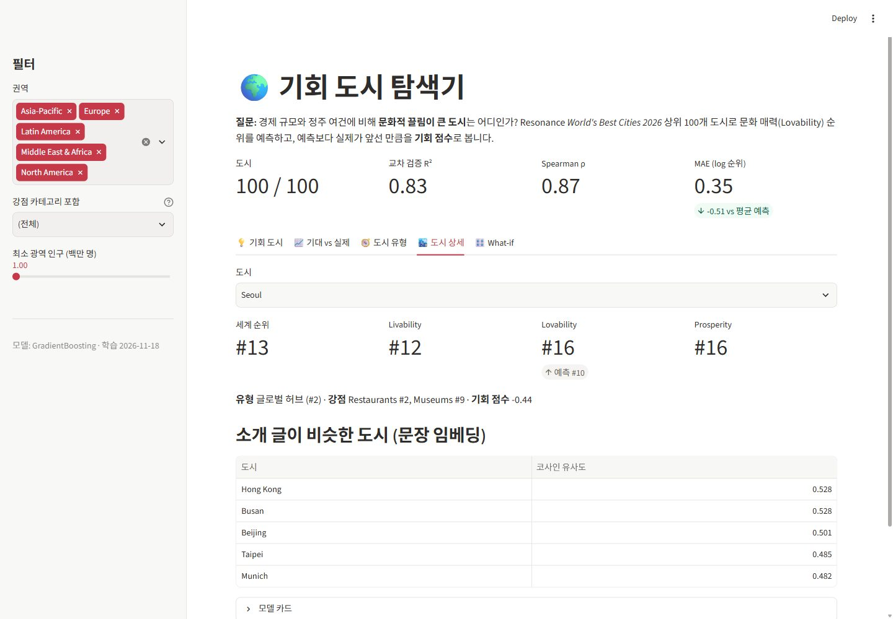
</p>

| 탭 | 하는 일 |
| --- | --- |
| 🎯 형식별 추천 | 팝업·비상설 전시·상설 전시를 고르면 적합도 상위 15개와 구성 요소별 기여(누적 막대), 가중치 조정 |
| 💡 기회 도시 | 권역·강점 카테고리·인구로 거른 뒤 기회 점수 상위 15개 (Plotly 막대 + 표) |
| 📈 기대 vs 실제 | out-of-fold 예측과 실제 순위 산점도, 대각선 위가 기회 도시 |
| 🧭 도시 유형 | PCA 2D 지도, 군집별 중앙 순위 |
| 🏙️ 도시 상세 | 세 축 순위·강점·기회 점수, 소개 글이 비슷한 도시 Top 5 |
| 🎛️ What-if | 순위·인구·권역을 바꾸면 joblib 모델이 기대 Lovability를 다시 계산 |

<a id="screens"></a>
## ✨ 7. 주요 화면

### 🌐 개요 `/overview`

<p align="center">
  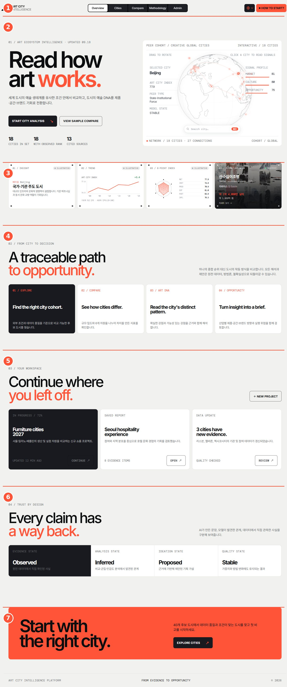
</p>

| 번호 | 섹션 | 내용 |
| :---: | --- | --- |
| 1 | 헤더 | 개요·도시·비교·방법론·관리자 메뉴, 문의 창 |
| 2 | 히어로 · 지구본 | "Read how art works." 드래그 회전·도시 검색, Ctrl/⌘ + 휠·핀치로 확대. 선택한 도시의 지수·유형·신호 3개 |
| 3 | 신호 타일 | 인사이트 · 추세 · 6점 지수 · 대표작(작품 설명 창) |
| 4 | 도시에서 결정까지 | 탐색 → 비교 → 예술 DNA → 기회의 4단계, 고른 도시로 바로 이동 |
| 5 | 숫자의 네 가지 상태 | Observed · Inferred · Proposed · Stable |
| 6 | 시작하기 · 푸터 | 18개 도시 탐색으로 이동 |

### 🏙️ 도시 상세 `/cities/[slug]`

<p align="center">
  
  
</p>

- 신호 대시보드 → 관측 순위(가장 앞선 축·가장 뒤처진 축) → 6개 차원 → 추세 → 유사 도시 순서
- 도시 유형·DNA, 위치·유산·변화 수용성·전망, 연계 산업과 기회 제안, 도시를 대표하는 작품
- 비교 `/compare`: 차원을 고르면 도시 점수와 18개 도시 중앙값의 차이를 문장과 막대로 보여 줌

<details>
<summary>서울 상세 전체 화면</summary>


</details>

### 🤖 기회 도시 `/opportunity` · 도시 상세의 모델 섹션

<p align="center">
  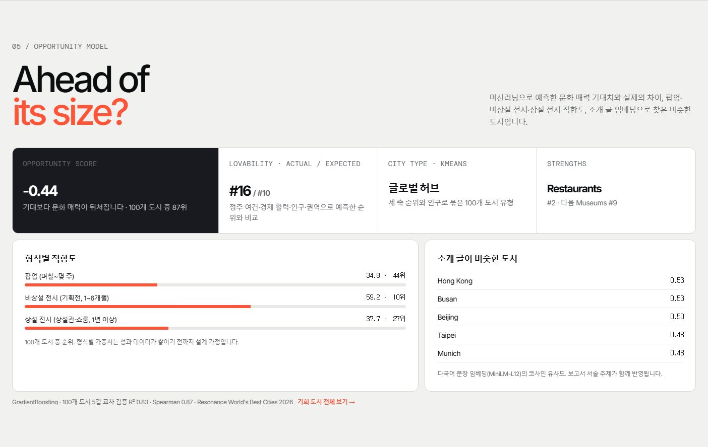
  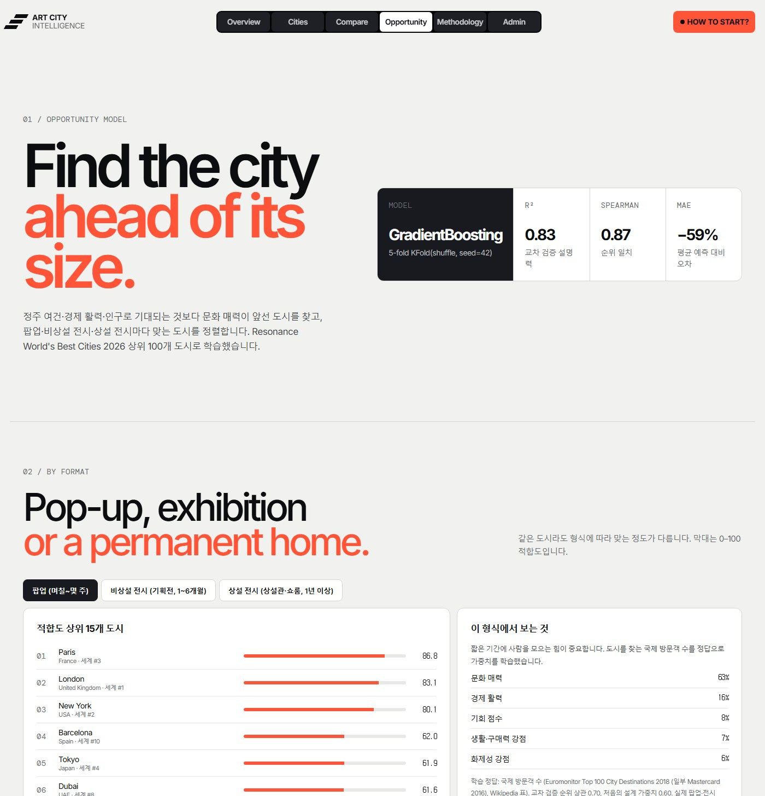
</p>

- 도시 상세 `05 / OPPORTUNITY MODEL`: 기회 점수(100개 도시 중 순위), 실제 vs 기대 Lovability, KMeans 도시 유형, 강점 카테고리, 팝업·비상설 전시·상설 전시 적합도와 순위, 소개 글 임베딩으로 찾은 비슷한 도시 5곳. 세계 100위 표 대상이 아닌 바젤·베네치아는 이유를 안내
- `/opportunity`: 형식 탭(팝업 · 비상설 전시 · 상설 전시)으로 적합도 상위 15개와 가중치, What-if 폼은 FastAPI `/api/opportunity/predict`(joblib 모델)를 호출
- 정적 수치는 빌드 전에 `export_snapshot.py`가 API와 같은 함수로 만든 스냅숏에서 읽고, What-if만 실행 중에 API를 부름

### 📖 방법론 · 🛠️ 관리자

<p align="center">
  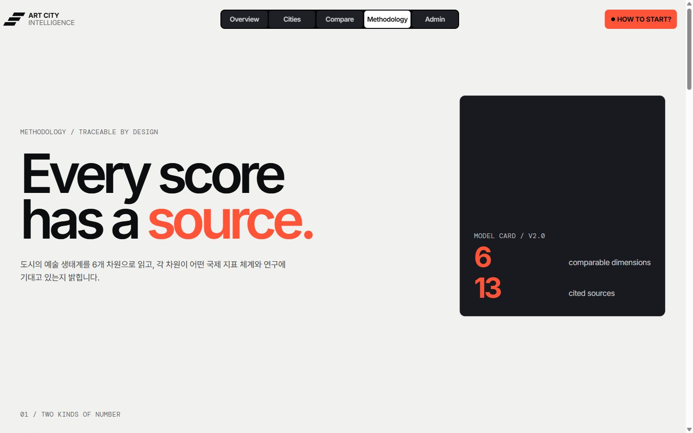
  
</p>

- 방법론: 두 종류의 숫자, 차원과 근거 문헌 대응표, 처리 단계, 알려진 한계, 문헌 13건
- 관리자: 도시별 관측 데이터 보유 상태(세계+권역 / 권역만), 지표·출처·검증 목록 (읽기 전용, Basic 인증)

<a id="details"></a>
## 🧩 8. 기능별 핵심 특징과 구현 상세

| 기능 | 핵심 특징 | 구현 상세 |
| --- | --- | --- |
| 🌐 지구본 | 드래그 회전, 도시 마커·툴팁, 검색, Ctrl/⌘ + 휠·핀치 확대 (일반 휠은 페이지 스크롤) | `components/globe/ArtGlobe.tsx` `GlobeInteraction.tsx` · Canvas, 육지 경계는 `scripts/build-land-polygons.mjs`가 Natural Earth 110m TopoJSON을 `public/textures/land-polygons.json`으로 변환 |
| 📊 6개 차원 점수 | 차원별 점수와 ± 민감도 | `backend/app/services/scoring.py` `city_indicators` · 정의는 `data/dimensions_v1.json`(C3 하위지수·근거 문헌·가중치) |
| ⚖️ 중앙값 비교 | 18개 도시 중앙값 대비 차이, 신호 3개의 순위 | `scoring.py` `cohort_medians` `signal_stats` · 반올림은 기존 화면과 같게 `round1` · `CompareExplorer.tsx` |
| 🛰️ 관측 순위 | 세계·권역 순위와 세 축, 가장 앞선·뒤처진 축 해석 문장 | `backend/app/services/observed.py` `read_rank` · `data/observations_v1.json` · `ObservedPositionBoard.tsx` |
| 🤖 기회 점수 모델 | 100개 도시 Lovability 기대치, out-of-fold 잔차로 기회 점수 | `ml/notebooks/art_city_opportunity_model.ipynb` · `make_pipeline(log·표준화·원-핫, GradientBoostingRegressor)` → `ml/models/lovability_model.joblib` |
| 🧠 문장 임베딩 | 소개 글로 비슷한 도시 Top 5 | `sentence-transformers` MiniLM-L12 · 코사인 유사도 → `ml/data/similar_cities_2026.json` |
| 🎯 형식별 적합도 | 팝업·비상설·상설마다 다른 조건을 가중합 | `ml/app/formats.py` `components` `fit_scores` · `python ml/app/formats.py`로 가중치 합·범위·형식별 순위 차이를 assert |
| 📊 Streamlit | 6개 탭, 필터, 형식별 가중치 조정, What-if 예측 | `ml/app/streamlit_app.py` · `st.cache_resource`로 joblib 한 번만 로드 · Plotly |
| 📄 보고서 추출 | PDF 요약표·3단 도시 페이지를 표로 | `ml/scripts/extract_resonance.py` · pdfplumber, 열 경계 자동 탐지, 1–100 누락 assert |
| 🔁 스냅숏 | 정적 페이지가 API와 같은 계산 결과를 읽음 | `backend/scripts/export_snapshot.py` → `src/data/snapshot_v1.json` · `features/*`는 읽기만 함 |
| 🏷️ 출처 상태 배지 | OBSERVED / ILLUSTRATIVE 구분 | `types/provenance.ts` · `components/evidence/DataBadge.tsx` |
| 📚 문헌 대장 | 차원·화면마다 근거 문헌 연결 | `features/evidence/sources.ts` (`SourceId`, `citation`) |
| 🖼️ 대표작 | 도시별 작품의 의미·의도·도시와의 연결 | `SignatureWorkModal.tsx` · `SignatureWork` 타입 |
| 🔌 조회 API | 잘못된 주소 이름은 400, 없는 도시는 404 | `backend/app/routers/cities.py` · `parse_slug` |
| ✉️ 문의 | 빈 칸·이메일 형식 검사, HTML 이스케이프, 봇 차단 칸, 키가 없으면 503, 발송 실패 502 | `backend/app/routers/contact.py` · `httpx` → Resend API |
| 🔐 관리자 인증 | `/admin/*`만 Basic 인증, 환경 변수가 없으면 잠김 | `src/proxy.ts` · `ADMIN_USER` `ADMIN_PASSWORD` |
| 🇰🇷 한국어 조사 | 받침에 따라 은/는 · 이/가 · 을/를 자동 선택 | `src/lib/korean.ts` · `backend/app/korean.py` |

<a id="decisions"></a>
## 💡 9. 기술적 의사결정

| 결정 항목 | 채택안 | 검토한 대안 | 이유 |
| --- | --- | --- | --- |
| 지표 체계 | EU C3 하위지수 아래 6개 차원 | 자체 지표를 새로 정의 | 국제 지표 체계에 기대야 차원 정의를 설명할 수 있음 |
| 비교 기준 | 18개 도시 중앙값 대비 | 절대값 순위 | 대도시가 총량에서 늘 유리한 문제를 줄임 |
| 불확실성 표시 | 가중치 ±10% 민감도 | 대규모 시뮬레이션 | C3 통계 감사에서 가중치가 가장 큰 불확실성 원인. 범위를 줄이면서 같은 질문에 답함 |
| 숫자의 종류 | 관측값과 예시값을 배지로 분리 | 하나의 점수로 통합 | 실측 순위는 Resonance 하나뿐이라, 섞으면 예시 점수가 실측처럼 읽힘 |
| 시각화 | SVG·Canvas 직접 구현 | 차트·지도 라이브러리 | 지구본과 레이더의 형태를 디자인에 맞추고 의존성을 줄임 |
| 백엔드 | FastAPI (Python) | Next.js Route Handlers 유지 | 다음 단계의 실측 수집·통계(표준화·결측 처리)·LLM 브리프를 Python 생태계에서 바로 붙일 수 있음 |
| 계산 위치 | Python 한 곳에서 계산, 화면은 스냅숏을 읽음 | 화면(TS)과 API(Python)가 각자 계산 | 같은 숫자를 두 언어로 계산하면 언젠가 어긋남. `verify_backend.py`가 일치를 검사 |
| 데이터 저장 | 버전 JSON + 출처 규칙·필드 정의 | DB | 쓰기가 없는 18개 도시 스냅숏. 버전과 출처를 파일로 남겨 되짚기 쉬움 |
| 배포 | Vercel(화면) + Render(FastAPI), `/api/*` rewrite | 서버 하나 | 화면은 CDN으로, 메일 키는 API 서버에만. 같은 주소라 CORS가 필요 없음 |
| 전환 검증 | 기존 API 응답 93건을 기록해 새 API와 비교 | 화면을 눈으로 확인 | 상태 코드·문구·숫자까지 같은지 자동으로 확인 |
| 학습 데이터 | Resonance 2026 상위 100개 도시 (실측 순위) | 리포트 18개 도시의 예시 점수 | 예시값으로 학습하면 모델이 돌아가도 결과에 의미가 없음. 100개 도시는 이미 확보한 보고서에서 바로 추출 가능 |
| 모델 질문 | 기대보다 문화 매력이 앞선 정도(잔차) | 문화 매력 순위 자체를 예측 | 순위 자체는 이미 공개돼 있음. 가치는 '기대와의 차이'에서 나옴 |
| 서빙 모델 | 그래디언트 부스팅 (joblib) | MLP (PyTorch) | 성능 차이가 잡음 수준이고, 서빙에 torch가 필요 없음 |
| 딥러닝 위치 | 소개 글 임베딩(사전학습 모델) | 표 데이터에 깊은 신경망 | 100행 표 데이터에는 신경망이 유리하지 않음. 텍스트는 사전학습 모델이 강함 |
| 형식별 추천 | 형식마다 설명 가능한 가중합 (가중치 공개·조정 가능) | 형식별 지도 학습 모델 | 형식별 성과 데이터가 아직 없음. 가중치를 숨기지 않고 보여 주고, 성과가 쌓이면 학습으로 바꿈 |
| 서빙 도구 | Streamlit + joblib | FastAPI에 모델 엔드포인트 | 분석가가 필터·What-if를 바로 쓰는 탐색 도구가 먼저. 같은 joblib을 FastAPI에서도 불러올 수 있음 |
| 관리자 보호 | Proxy Basic 인증 (환경 변수 계정 하나) | 회원 DB·OAuth | 관리자 화면이 읽기 전용이라 계정 하나로 충분. 편집 기능이 생기면 계정 체계로 옮김 |
| 미완성 화면 | 삭제 | '예시' 표시를 붙여 유지 | 진행률·갱신 시각 같은 가짜 상태가 실제 데이터처럼 읽힘 |
| 제작 방식 | 기획·조사·설계는 직접, 구현은 AI 코딩 도구 후 검수 | 전부 직접 구현 | 1인 프로젝트에서 조사와 설계에 시간을 씀 |

<a id="structure"></a>
## 📂 10. 주요 폴더 구조와 데이터 모델

```text
art-city-intelligence/
├─ backend/                        # FastAPI (Render)
│  ├─ main.py                      # 라우터 연결 · uvicorn main:app
│  ├─ app/
│  │  ├─ routers/                  # cities(조회 4) · contact · meta(health·meta) · opportunity(형식 순위·예측)
│  │  ├─ services/                 # scoring · observed · opportunity(joblib·formats) · snapshot
│  │  ├─ data.py · config.py · korean.py
│  ├─ data/                        # cities · dimensions · observations · sources · provenance · field_dictionary (_v1.json)
│  ├─ scripts/export_snapshot.py   # src/data/snapshot_v1.json 생성
│  ├─ tests/baseline/              # 기존 Next.js API 응답 93건 · TS 계산 결과
│  └─ requirements.txt
├─ src/                            # Next.js (Vercel)
│  ├─ proxy.ts                     # /admin/* Basic 인증
│  ├─ app/
│  │  ├─ (public)/                 # overview · cities/[citySlug] · compare · methodology
│  │  └─ (admin)/admin/            # cities · indicators · sources · validation
│  ├─ data/snapshot_v1.json        # Python이 계산한 값 (직접 고치지 않음)
│  ├─ features/                    # 스냅숏 읽기: city-intelligence · comparison · evidence
│  ├─ components/                  # globe · charts · city · evidence · layout · ui
│  ├─ types/ · lib/                # 타입 · 형식 · 한국어 조사
│  ├─ img/                         # 도시별 대표작 이미지
│  └─ report/                      # 근거 문헌 PDF
├─ ml/                             # 기회 도시 모델 (Colab 학습 · Streamlit 서빙)
│  ├─ scripts/extract_resonance.py # 보고서 PDF → world_cities_2026.csv
│  ├─ notebooks/art_city_opportunity_model.ipynb  # EDA · 모델 비교 · 군집 · 임베딩 · joblib 저장
│  ├─ data/                        # world_cities_2026 · city_scores_2026 · similar_cities_2026 (private/는 git 제외)
│  ├─ models/                      # lovability_model.joblib · city_clusters.joblib · model_card.json
│  ├─ reports/figures/             # Matplotlib 그림
│  ├─ app/streamlit_app.py · formats.py(형식별 적합도) · requirements.txt
│  └─ requirements-train.txt
├─ scripts/
│  ├─ verify_backend.py            # API·계산·스냅숏·문의 일치 검사
│  └─ build-land-polygons.mjs      # 지구본 육지 경계 생성
├─ public/
│  ├─ slides.html                  # 슬라이드 20장 (/slides.html)
│  └─ textures/land-polygons.json
├─ render.yaml                     # Render 배포 설정
└─ docs/                           # slides · screenshots
```

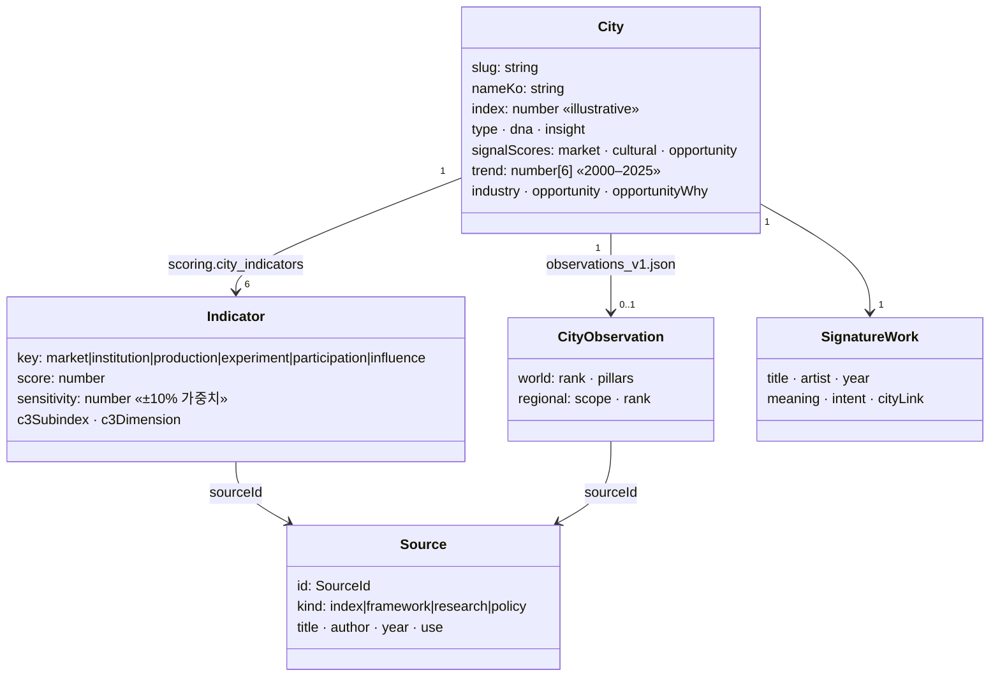

<a id="run"></a>
## 🚀 11. 실행 방법

### 💻 방법 1. 내 컴퓨터에서 실행

Node.js 20 이상과 Python 3.12 이상이 필요합니다. 터미널 두 개를 씁니다.

```bash
git clone https://github.com/beang66/art-city-intelligence.git
cd art-city-intelligence

# 1) FastAPI — http://127.0.0.1:8000 (문서: /docs)
cd backend
python -m venv .venv && source .venv/bin/activate   # Windows: .venv\Scripts\activate
pip install -r requirements.txt
uvicorn main:app --reload

# 2) Next.js — http://localhost:3000, /api/*는 :8000으로 넘어감
npm install
npm run dev
```

데이터(`backend/data/*.json`)를 고친 뒤에는 스냅숏을 다시 만들고 검사합니다.

```bash
python backend/scripts/export_snapshot.py   # src/data/snapshot_v1.json 갱신
python scripts/verify_backend.py            # API 93건 · 계산 · 스냅숏 · 문의 검사
npm run typecheck && npm run build
```

| 환경 변수 | 어디에 | 필수 | 설명 | 없을 때 동작 |
| --- | --- | --- | --- | --- |
| `API_ORIGIN` | Vercel | 배포 시 | FastAPI 주소 (예: `https://art-city-intelligence-api.onrender.com`) | 로컬은 `http://127.0.0.1:8000`, Vercel에서는 빌드 실패 |
| `ADMIN_USER` · `ADMIN_PASSWORD` | Vercel | 관리자 화면을 쓸 때 | 관리자 Basic 인증 계정 | `/admin/*`가 401로 잠김 |
| `RESEND_API_KEY` | Render | 문의 메일을 쓸 때 | Resend API 키 | 문의 전송 시 503 안내 |
| `CONTACT_FROM_EMAIL` | Render | 문의 메일을 쓸 때 | 인증한 도메인의 보내는 주소 | Resend 기본 주소 |

### 🤖 모델 학습 · Streamlit

```bash
# 학습 — Google Colab에서 배지를 눌러 '모두 실행' (저장소를 받아 ml/requirements-train.txt 설치)
# 로컬에서는:
python -m venv ml/.venv && source ml/.venv/bin/activate
pip install -r ml/requirements-train.txt -r ml/app/requirements.txt torch jupyter
python ml/scripts/extract_resonance.py          # 보고서 PDF → CSV (+ 임베딩용 private 소개 글)
jupyter nbconvert --to notebook --execute --inplace ml/notebooks/art_city_opportunity_model.ipynb

# 서빙
streamlit run ml/app/streamlit_app.py          # http://localhost:8501
```

### ☁️ 방법 2. 배포 (Render + Vercel)

1. **Render** — New → Blueprint로 저장소를 고르면 `render.yaml`대로 `backend/`가 배포됩니다. `RESEND_API_KEY`·`CONTACT_FROM_EMAIL`을 넣고, `https://<서비스>.onrender.com/health`가 `{"status":"ok"}`인지 확인합니다.
2. **Vercel** — Environment Variables에 `API_ORIGIN`(Render 주소)과 관리자 계정 두 값을 넣고 다시 배포합니다.
3. **Streamlit Community Cloud** — New app → 저장소, Main file `ml/app/streamlit_app.py` (패키지는 `ml/app/requirements.txt`).
4. `main`에 푸시하면 세 곳이 함께 배포되고, [art-city-intelligence.vercel.app](https://art-city-intelligence.vercel.app/)의 `/api/*`가 Render로 연결됩니다.

<a id="verify"></a>
## ✅ 12. 검증 결과

기준일 2026.11.19 · Next.js 16.4.6 · FastAPI · Python 3.14(로컬) / 3.12(배포)

| 항목 | 방법 | 결과 |
| --- | --- | --- |
| API 전환 | 전환 전 Next.js API 응답 93건(도시 18 × 엔드포인트 4, 잘못된 주소·없는 도시·문의 오류 포함)을 기록 → `scripts/verify_backend.py`로 FastAPI 응답과 비교 | 93/93 일치 (상태 코드·문구·숫자). 대표작 이미지 객체는 프런트엔드 자산이라 비교에서 제외 |
| 계산 이전 | 기존 TypeScript 계산 결과(차원 점수·신호 순위·순위 해석·중앙값 2종·지수 순위)와 Python 결과 비교 | 6/6 일치 |
| 화면과 API 일치 | `src/data/snapshot_v1.json` = API와 같은 함수로 다시 계산한 값 | 일치 |
| 문의 발송 | Resend를 모의 응답으로 바꿔 시험 | 200 → 200, 422 → 502, 입력의 HTML 이스케이프 확인 |
| 타입 검사 · 빌드 | `npm run typecheck` · `npm run build` | 통과, 정적 페이지 29개(`/opportunity` 포함) · Proxy 1개 |
| 함께 실행 | `uvicorn` + `next start`, `/api/*` rewrite를 거쳐 요청 | 조회 200 · 없는 도시 404 · 잘못된 주소 400 · 문의 빈 칸 400, 화면 5종 200, 런던 상세 순위 해석 문장 표시 |
| 관리자 인증 | `/admin/cities` 요청 3회 | 인증 없음 401 · 틀린 비밀번호 401 · 맞는 비밀번호 200 |
| 의존성 보안 | `npm audit --omit=dev` | 0건 |
| 보고서 추출 | `extract_resonance.py`의 assert (요약표 순위 1–100, 도시 페이지 100개) | 통과. 리포트 18개 도시의 관측 순위를 이 표와 대조해 오류 11곳 수정 |
| 모델 노트북 | Windows · Python 3.14 · torch 2.15 CPU에서 `nbconvert --execute` | 처음부터 끝까지 실행, 결과 표·그림·joblib·임베딩 생성 |
| Streamlit | `streamlit run` 후 6개 탭 열기, 형식 3종 전환 | 오류 없이 표시, 형식마다 다른 순위, 도시 상세에서 임베딩 기반 유사 도시 표시 |
| 웹 모델 화면 | 헤드리스 Chromium으로 `/opportunity` 형식 탭·What-if 제출, `/cities/seoul`·`/cities/venice` 모델 섹션 | 비상설 1위 파리 · 상설 1위 런던, What-if가 rewrite를 거쳐 FastAPI 예측 표시, 서울 기회 점수·비슷한 도시 표시, 베네치아 대상 아님 안내, 페이지 오류 0 |
| 모델 API | `verify_backend.py` — 형식 순위, What-if 예측, 잘못된 입력 | 상설 상위 3개가 Streamlit과 같음, 더 좋은 조건일수록 기대 순위가 좋아짐, 범위 밖 입력 400 |
| 형식 적합도 | `python ml/app/formats.py` | 가중치 합 1, 점수 0–100, 팝업과 상설 전시 상위 5개가 다름 |
| 확인하지 않은 범위 | — | Render·Streamlit Cloud 배포본, Colab 런타임에서의 실행, 모바일 화면, 문의 메일 실제 발송 |

<a id="retro"></a>
## 📈 13. 회고

### 🔧 코드 검토로 해결한 문제

| 문제 | 원인 | 해결 |
| --- | --- | --- |
| README와 슬라이드가 예시 점수를 실측처럼 서술 | 관측값과 예시값을 문서에서 나누지 않음 | 문서를 코드에 맞춰 다시 쓰고, 화면과 같은 [해석 원칙](#interpret) 표를 둠 |
| 작업 공간 카드에 '72% 진행', '12분 전 갱신', 데이터에 없는 리스본·밀라노 | 연결되지 않은 예시 화면 | 섹션 삭제, 'AI가 만든 문장' 문구를 실제 기능에 맞춤, '40개 후보 도시' → 18개 |
| EN을 눌러도 언어가 바뀌지 않음 | 동작이 없는 언어 메뉴 | 메뉴와 스타일 삭제 (−44줄) |
| 관리자 화면을 누구나 열 수 있음 | 인증 없음 | `src/proxy.ts` Basic 인증, 환경 변수가 없으면 잠김 |
| `npm audit` critical 1 · high 2 | `next` 16.3.5가 취약 범위, `sharp`·`source-map-js` | `next` 16.4.6 · `npm audit fix` → 0건 |
| 서울 상세 문장이 '유연한 형식를' | 조사를 '를'로 고정 | `withObject()`로 받침에 맞춰 을/를 |
| 지구본 위에서 휠을 굴리면 페이지가 내려가지 않음 | 휠 이벤트를 늘 막고 확대로 씀 | Ctrl/⌘ + 휠과 핀치만 확대 |
| 중앙값 계산이 세 곳에 복사됨 | 함수마다 같은 코드 | `median()` 하나로 합침 |
| 유일한 실측값인 관측 순위가 한 칸씩 밀려 있음 (런던 1위 → 2위로 표기, 베이징 세계 15위 누락) | PDF를 손으로 옮기며 위 도시의 값을 다음 도시에 적음 | 보고서 요약표를 스크립트로 다시 추출해 18개 도시 대조 → 11곳 수정 (`observations_v1.json` v1.1) |
| 모델 결과를 웹 리포트에서 볼 수 없음 | 모델이 Streamlit에만 연결됨 | FastAPI `/api/opportunity`·`/predict`가 같은 joblib과 `formats.py`를 쓰고, 도시 상세 모델 섹션과 `/opportunity` 페이지 추가 |
| 데이터와 계산이 화면 코드(TypeScript) 안에 있음 | 처음부터 화면 안에서 계산 | FastAPI로 옮기고 데이터는 버전 JSON, 화면은 Python이 만든 스냅숏을 읽음. 기존 응답 93건·계산 6종 일치 확인 |

### ⚠️ 남은 중요한 문제

| 순서 | 문제 | 왜 중요한가 | 다음 행동 |
| :---: | --- | --- | --- |
| 1 | 리포트 화면의 6개 차원 점수가 `지수 × 고정 가중치` | 모든 도시에서 실험 > 시장 > 영향력 순서가 같아, '순위 하나는 강점의 조합을 숨긴다'는 기획 질문에 답하지 못함 | 로드맵 1: '기관' 차원부터 도시별 문화 시설 수(인구 대비)로 교체 |
| 2 | 기회 점수와 형식별 가중치가 실제 사업 성과로 검증되지 않음 | 모델은 '기대보다 문화 매력이 앞선 도시'를 찾을 뿐, 그 도시에서 팝업·전시가 잘 되는지는 모름. 형식별 가중치는 설계 가정 | 팝업·비상설·상설 1건마다 도시·형식·기간·방문·매출을 기록해 적합도와의 상관을 보고 가중치를 맞춤 (로드맵 3) |
| 3 | 공개 저장소에 보고서 PDF 13개(약 100MB, 단행본 포함)와 작품 이미지 20점 | 발행 기관·작가에 권리가 있는 자료를 그대로 배포 | PDF는 저장소에서 빼고 링크로, 작품 이미지는 이용 허락 확인 또는 교체 |
| 4 | 검사가 CI에 연결되지 않음 | `verify_backend.py`가 API·계산·스냅숏을 검사하지만 사람이 실행해야 하고, 관리자 인증은 아직 수동 확인 | GitHub Actions에서 `verify_backend.py`·빌드·`npm audit` 실행 |

| Keep | Problem | Try |
| --- | --- | --- |
| 차원마다 근거 문헌을 붙이고 관측값과 예시값을 배지로 나눠, 숫자의 출처를 화면에서 바로 확인하게 함 | 차원 점수가 지수의 배수라 비교 화면이 도시마다 같은 모양 | 실측 지표 하나를 끝까지 연결한 뒤 화면을 늘림 |
| 40개 도시·대규모 시뮬레이션을 18개 도시·민감도로 줄여 끝까지 배포 | 연결되지 않은 화면을 오래 둠 | 동작하지 않는 화면은 만들지 않거나 바로 지움 |

<a id="roadmap"></a>
## 🗺️ 14. 로드맵

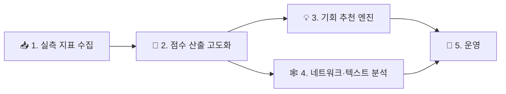

| 단계 | 할 일 | 필요한 데이터·작업 | 완료 기준 |
| --- | --- | --- | --- |
| 📥 1. 실측 지표 수집 | '기관' 차원부터 6개 차원 예시 점수를 공개 지표로 교체, 원자료는 CSV로 | C3 지표 정의에 맞춘 도시별 기관 수·창조 일자리·행사·국제 연결 데이터, 수집일·출처 기록, 변환 스크립트 | 교체한 차원에 `OBSERVED` 배지, 도시마다 차원 모양이 달라짐, 원자료와 화면 값 대조 테스트 통과 |
| 🧮 2. 점수 산출 고도화 | 규모와 밀도 분리, 이상치에 강한 표준화 | 인구 대비 지표, Robust Z-score, 결측 처리 | 점수마다 계산식과 원자료로 되짚어 감 |
| 💡 3. 기회 추천 엔진 | 기회 점수·형식 적합도를 FastAPI `/api/opportunity`로 연결, 사업 조건(산업·형식·권역) 필터, 근거 문장은 LLM이 근거 표로만 작성 | 팝업·비상설·상설 결과 기록(도시·형식·기간·방문·매출) | 추천마다 근거와 출처 표시, 형식별 10건 이상에서 적합도와 성과의 상관을 보고 가중치를 데이터로 맞춤 |
| 🕸️ 4. 네트워크·텍스트 분석 | 기관·작가·행사 관계망, 비평·보도 텍스트에서 도시 키워드 | 관계 데이터, 텍스트 말뭉치 | 도시 DNA 문구를 분석 결과로 대체 |
| 🔐 5. 운영 | 데이터 갱신 화면, 계정 체계, 자동 점검 | 갱신 이력, 테스트, CI | 갱신마다 이력이 남고, CI에서 테스트·`npm audit` 통과 |

<a id="slides"></a>
## 🎞️ 15. 슬라이드

<p align="center">
  <a href="https://art-city-intelligence.vercel.app/slides.html"></a>
</p>

<div align="center">

[](https://art-city-intelligence.vercel.app/slides.html)

</div>

문제 → 해결 설계 → 화면 → 기술과 검증 → 다음 단계 순서의 HTML 슬라이드 20장(본문 18 · 부록 2, 약 13분)입니다. 방향키로 넘기고, 목차(T), 발표자 노트(P), 전체 화면(F), 캡처를 눌러 확대할 수 있습니다. 원본: [`public/slides.html`](public/slides.html)

<details open>
<summary>슬라이드 20장 보기</summary>

<p align="center">


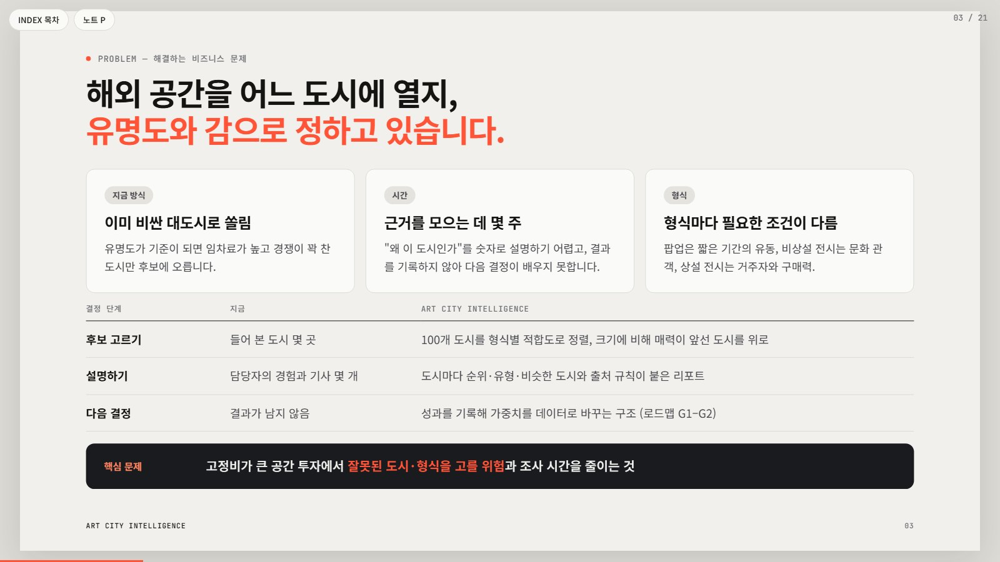


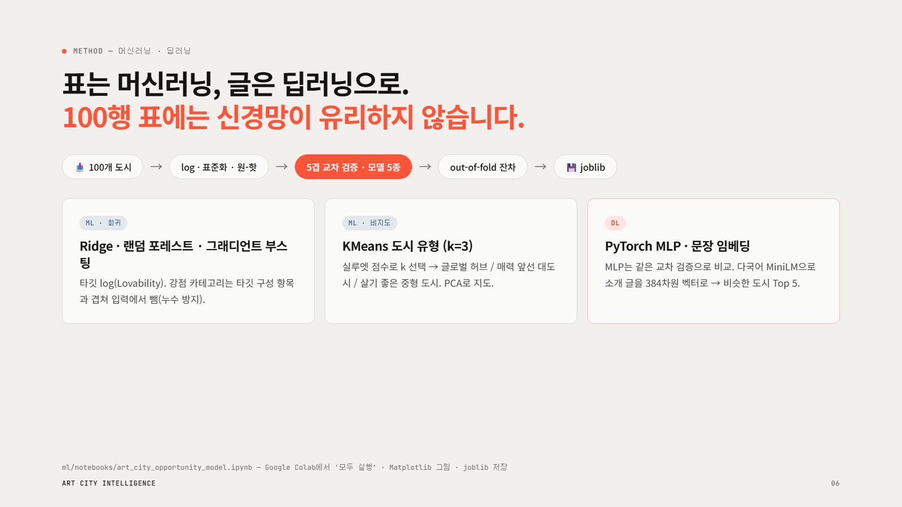
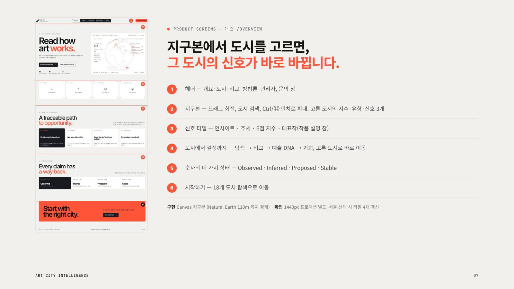
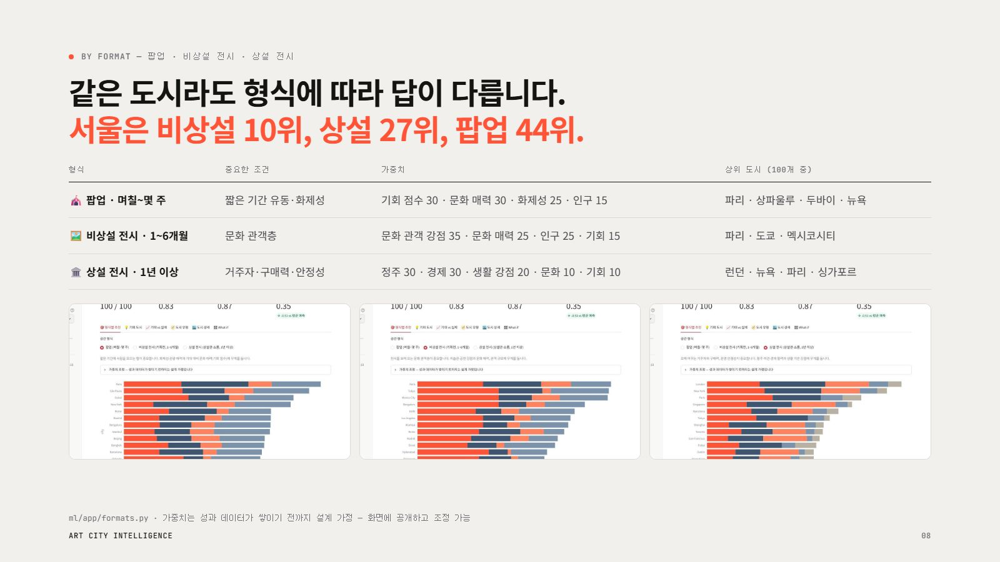
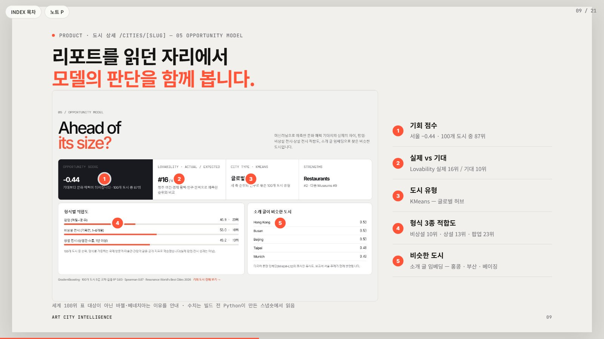

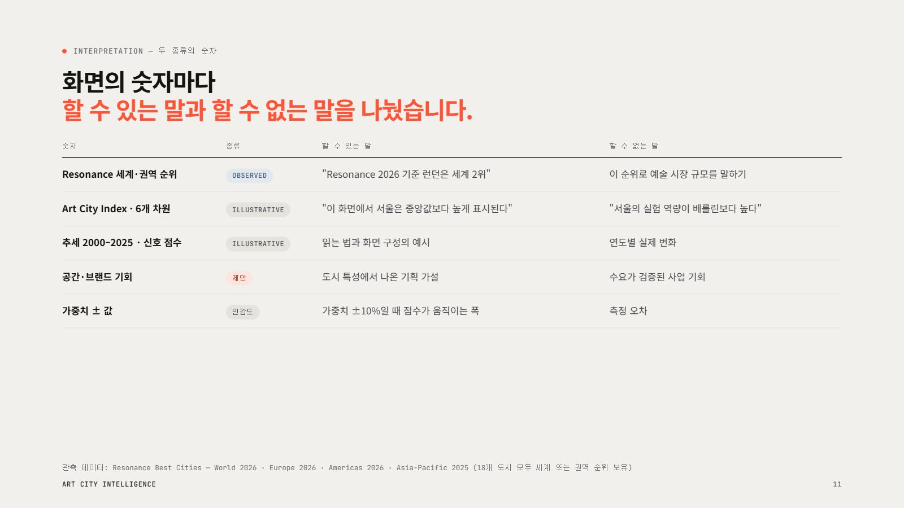
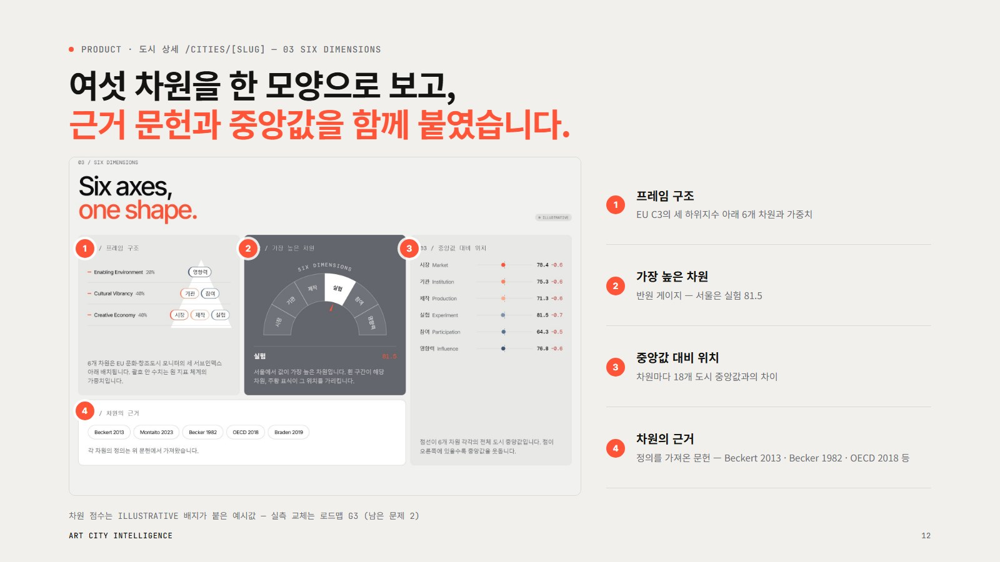

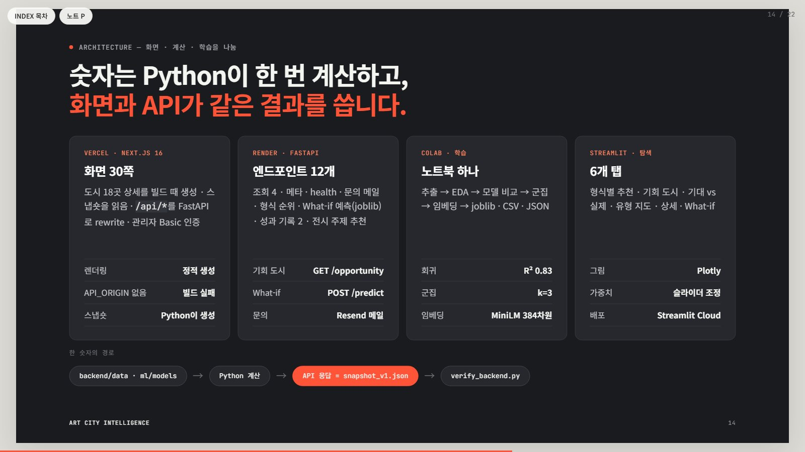
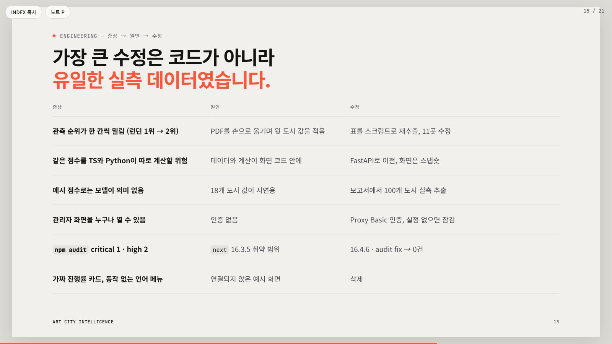
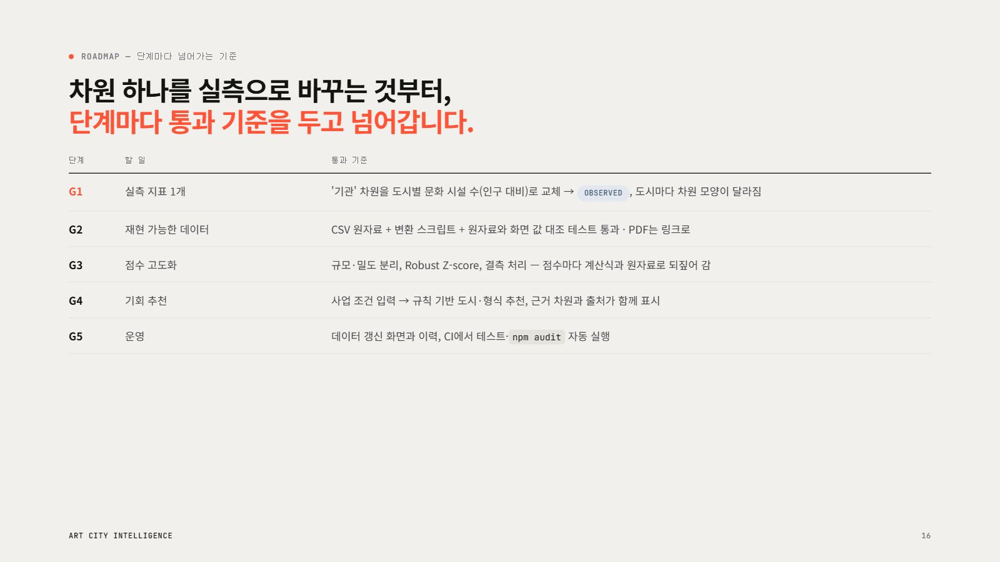
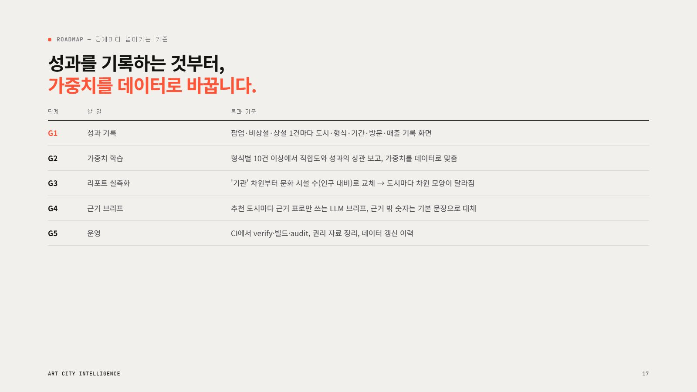


</p>
</details>

<a id="license"></a>
## 📄 16. 라이선스와 자료 권리

개인 포트폴리오 프로젝트로, 오픈소스 라이선스를 두지 않았습니다. `src/img`의 작품 이미지는 각 작가와 소장처, `src/report`의 보고서는 각 발행 기관에 권리가 있습니다. 지구본 육지 경계는 Natural Earth(퍼블릭 도메인) 데이터를 썼습니다.

<div align="center">
<br>
<strong>🌍 Art City Intelligence</strong> · From evidence to opportunity<br>
안정빈
</div>
